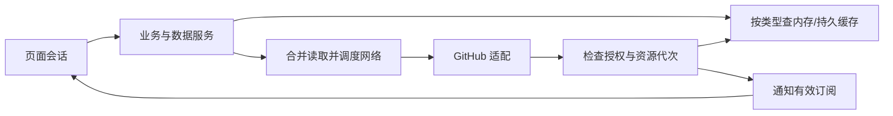

# 架构方案与状态边界

更新：2026-10-23。Rust + GPUI + Ely、PAT 登录、多账户保存但单账户活动、离线阅读已确认。正式工程采用单 Cargo package；UI 侧仍是 R1 的外壳布局（自定义标题栏、固定侧边栏、island、应用级基础标签、本地导航与搜索浮层），没有登录页面、账户切换界面或业务页面。R2 的服务切片已实现但**尚未接入 UI**：认证、凭据、账户代次与两个 GitHub 读取接口真实存在，具体接口与边界见 [认证与网络](auth-and-network.md)。数据库、缓存与私有内容保留政策仍未定。

## 建议的职责划分

| 部分 | 职责与边界 |
| --- | --- |
| UI / design system | Ely 组件组合、页面和交互；不在绘制回调中发网络或执行阻塞存储 |
| Workspace / session | 窗口外壳、应用级标签、路由、页面会话和焦点；与数据缓存分开 |
| Application / data services | 统一业务入口、读取策略、在途请求合并、更新及失效、跨页通知 |
| Auth / accounts | 活动身份、凭据获取与替换、授权上下文；页面不直接持有 token |
| GitHub / network | REST/GraphQL 适配和字段转换；传输层处理超时、代理、限流与队列 |
| Storage | 设置、账户引用、结构化缓存、版本迁移；可清缓存与用户持久数据分开 |
| Content / assets | Markdown、源码预处理、图片、相对链接；后台处理纯数据，排版绘制回 UI |
| Platform / runtime | 窗口、字体、IME、系统凭据、外部浏览器、任务生命周期与取消 |
| Diagnostics / distribution | 脱敏日志、耗时和性能证据、安装与迁移；遥测/自动更新未定 |

工作区是某个窗口内组织页面会话的状态容器，不是本地 Git 工作目录。应用字体/主题可共享；活动账户拥有业务请求和缓存范围；工作区拥有标签顺序和当前标签；每个页面会话拥有自己的分支、文件、筛选、滚动与焦点。

`TabId` 标识会话（单调递增、关闭后不复用），`ResourceKey` 标识共享内容、仍属后续任务。当前产品规则不允许重复资源标签：`Route::key()` 折叠 GitHub 名称大小写，同一资源只保留一个会话；每个会话拥有自己的分支、文件、筛选、滚动与焦点。

## 请求与状态流转

请求开始时固定 host、稳定账户 ID 与授权代次。返回时先校验数据上下文，再更新缓存；通知页面时再核对 `TabId` 和当前资源。切账户、关标签、切分支后，旧响应不得覆盖新视图。写入/失效推进资源代次，防止早发晚到的读取盖掉新值。关闭一个页面不取消其他订阅仍需要的请求。

UI 事件启动后台工作，通过受控通道回到 GPUI；不能假设 GPUI 执行器天然等于 Tokio。**已实现并验证的最小切片**：`network::BackgroundExecutor` 在独立线程上运行 Tokio current-thread runtime，`reqwest` 只在该 runtime 上执行，取消用 watch token，关闭时先拒绝新工作、宽限期内排空再取消；SQLite 与具体缓存参数仍是候选。实现与证据见 [认证与网络](auth-and-network.md#4-网络与执行模型)。

账户与授权的实现状态：`domain::AccountKey`（host + 数字 id）是稳定隔离身份，`login` 仅显示；`auth::AuthEpoch` 在替换 PAT 或移除账户时推进，数据层在请求前捕获 `AuthContext` 并在返回时比对，不一致返回 `StaleContext` 且丢弃结果。凭据只经 `auth::CredentialStore` 进入 Windows Credential Manager，其他平台明确不支持且无明文回退；普通账户记录只持有 `CredentialRef`。GitHub 读取已实现 `GET /user` 与 `GET /user/repos`（完整 `Link` 分页、`Complete`/`Partial` 区分、SSO 部分结果、401/403/限流/超时/取消/解析失败分类），写权限只有 `Unknown` 占位。

## 认证与外部边界

首版正式登录采用 Classic PAT，产品选择与兼容性边界见 [登录与未来写能力](product.md#登录与未来写能力)。不建设认证后端；原型假数据不代表认证完成。凭据应使用平台凭据设施，普通设置/SQLite 仅保存账户元数据或凭据引用。token 不进入日志、任务包、PR 或缓存键正文。登录/替换时使用 `GET /user` 核对稳定账户身份；替换 PAT 推进授权代次，重新核验权限和资源可见性。PAT 过期/撤销走凭据替换流程，不套用 OAuth refresh token 流程。

当前读取链路须保留后续写能力的边界，但不提前建设完整编辑器或写操作框架：

- UI 通过业务动作调用服务；凭据取得和认证头由 auth/GitHub 层处理，不让页面绑定具体 token 格式。
- 动作可用性结合 token scope、账户对资源的权限、组织策略和实际服务端结果判断，不能仅凭持有 `repo` 或一次 `/user` 成功就宣称任意资源可写。权限未知与已确认不可用分开；缺权限时说明需要更新/替换授权。
- 读取可以合并在途请求和使用缓存；写操作有独立提交结果与失败处理，不复用读取缓存作为写入成功证据，也不合并语义不同的写请求。
- 成功写入后推进资源代次并更新或失效关联快照，防止旧读取覆盖新值；具体规则随每个动作落地。现阶段不为了“未来可能用到”预先要求所有管理 scope。

正式集成优先围绕公开、文档化 GitHub API 设计，具体权限、查询覆盖、分页和额度用实际账户验证。网页内部端点不是已确定的产品依赖；不要将浏览器 Cookie 方案或永久无限额度当作既定架构。

错误要区分离线、认证失效、权限不足、资源不可见、限流和解析失败。无缓存不是空数据；部分分页不是完整列表。远程写操作建议首轮要求在线，超时可能已在服务端生效，不能无条件重放。离线草稿与自动重放队列尚未承诺。

## 缓存和待确认事项

数据类型矩阵、快照/当前值的区别见 [缓存策略](cache-strategy.md)，页面不自行决定 SQL 和 TTL。账户移除及权限失效后的私有缓存政策、重启恢复、数据库迁移机制、容量和网络调度预算仍待细化。

## 已建立的工程边界

[`src/main.rs`](../src/main.rs) 是真实 binary 入口，[`app::run`](../src/app/mod.rs) 组合 GPUI、Ely、深色主题与窗口，并在启动时绑定外壳快捷键；[`workspace::Route`](../src/workspace/mod.rs) 是唯一地址模型，[`workspace::Workspace`](../src/workspace/mod.rs) 持有会话集合与活动标签，[`ui::Shell`](../src/ui/mod.rs) 持有工作区、侧栏滚动句柄与搜索浮层状态，[`platform::fonts`](../src/platform/fonts.rs) 注册编译进 binary 的字体。主题默认 Noto Sans / Google Sans Code；字体来源与许可见 [字体清单](../assets/fonts/README.md)。

外壳按职责拆开，避免所有布局挤在一个视图里：`src/ui/chrome.rs` 画标题栏与搜索入口，`src/ui/sidebar.rs` 画固定列与有界的仓库组，`src/ui/page.rs` 画岛内页面，`src/ui/tabs.rs` 画应用级标签条，`src/ui/palette.rs` 是本地导航浮层，`src/ui/geometry.rs` 集中放间距、宽度与圆角，`src/ui/fixtures.rs` 是确定性的本地面板数据。标题栏在所有平台绘制同一条品牌 + 搜索入口，只有 Windows 的三个窗口按钮由 `cfg!(target_os = "windows")` 控制；已确认行为（搜索入口固定在标题栏）不能挂在平台分支上。窗口拖动、双击最大化和边缘缩放使用 GPUI 的 `WindowControlArea` / `start_window_move`，由平台上已有的非客户区命中测试驱动，没有新增平台补丁。

`storage/content` 仍是边界说明，无业务实现。`domain/auth/network/github/data/diagnostics` 已有本切片的真实实现（见 [认证与网络](auth-and-network.md)），但**UI 与 app 入口尚未调用**，binary 里这些模块暂时是未使用代码，各自带一个写明原因的模块级 `dead_code` 允许，不是 crate 级屏蔽；接入 UI 后应移除。HTTP 与运行时已选定 `reqwest` + `tokio`（理由见同文）；数据库仍未选择。现有依赖中曾出现的相关库是框架传递依赖，不作为采用依据。

侧栏尺寸与收起状态由 `Shell::sidebar_state` 持有（`src/ui/sidebar_state.rs`），本次运行记住展开宽度，渲染按当前窗口预算 clamp；GPUI drag 生命周期与 Ely 菜单焦点同属视图，不进入路由、账户或存储。`src/ui/scrolling.rs` 提供共享的滚轮平滑适配（离散滚轮缓动、精确滚动直通、捕获阶段只消费一次），已接入侧栏仓库、island 页面与 palette 列表；它只持有各区域的 `ScrollHandle` 与呈现偏移，不进入数据层。几何与交互契约见 [侧栏布局](sidebar-layout.md)。

本轮状态归属：窗口只有一个活动页，`Workspace` 只保存当前 `Route`；`TabId`、页面会话集合与各自的分支/文件/滚动/焦点状态仍属于下一份 R1 任务。`Shell` 的滚动、浮层与焦点是视图局部状态，不进入将来的数据层。fixture 是布局验证数据，不是缓存或 API 模型，也没有任何网络、凭据或存储路径读取它。

本轮状态归属：窗口持有 `workspace::Workspace` 的有序 `Session` 集合与唯一活动标签；`Workspace::open` 按 `Route::key()` 打开或激活，`close` 选择邻居并在关闭最后一个标签时新建 Home，打开数量不设上限。每个 `Session` 拥有真实的 `ScrollHandle`、页面 `FocusHandle`、标签条 `FocusHandle` 与仓库会话选择（branch/file，R3 阅读器填充）；关闭会话即释放这些状态。标签条自身的横向偏移是 `Shell` 的视图局部状态（一个 `ScrollHandle`），由 GPUI 的横向溢出、`src/ui/tab_scrollbar.rs` 的细滚动条（自带 hover 淡入淡出状态，不改共享主题）、滚轮、中键关闭与拖拽排序驱动，与页面滚动、侧栏滚动互不影响。拖拽只是按稳定 `TabId` 移动 `Session` 在集合中的位置（`Workspace::reorder`），不关闭、不重建会话，也不改变活动标签；落地槽位由滚动视口的实际偏移与宽度算出，工具栏在视口之外，因此不可能是投放目标。`Shell` 的侧栏滚动、浮层与根焦点同样是视图局部状态，不进入将来的数据层。fixture 是布局验证数据，不是缓存或 API 模型，也没有任何网络、凭据或存储路径读取它。账户切换时如何处理标签仍未决定。

GPUI 基线为 `gpui-pre` / `gpui-pre-platform` 0.3.8（`font-kit`），Ely 固定 Git revision `da3fdcaf39f2fa85ce1dd9cad07c3c81cf1dd721`，不引用原型 path 或共享 target。当前使用未打补丁的上游；以后接入输入/只读编辑器时，先验证原型 IME/readonly 问题是否仍可重现，再决定上游升级或最小补丁。搜索浮层没有直接复用 Ely 的 `CommandPalette`：后者在任何 Enter 上运行高亮行，而输入法候选确认也可能是 Enter，因此浮层自绘卡片并在按键绑定前拦截按键、检查查询框的 marked 区间。构建命令见 [README](../README.md)，真实验收证据见 [本轮开发日志](devlog/2026-10-22-shell-layout.md)。
