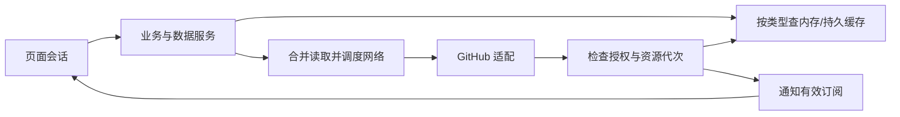

# 架构方案与状态边界

更新：2026-10-21。Rust + GPUI + Ely、多账户保存但单账户活动、离线阅读已确认。正式工程采用单 Cargo package，当前仅实现 Hello 桌面窗口；业务职责仍是扩展边界，不代表功能已实现。

## 建议的职责划分

| 部分 | 职责与边界 |
| --- | --- |
| UI / design system | Ely 组件组合、页面和交互；不在绘制回调中发网络或执行阻塞存储 |
| Workspace / session | 窗口外壳、应用级标签、路由、页面会话和焦点；与数据缓存分开 |
| Application / data services | 统一业务入口、读取策略、在途请求合并、更新及失效、跨页通知 |
| Auth / accounts | 活动身份、凭据获取与替换、授权上下文；页面不直接持有 token |
| GitHub / network | REST/GraphQL 适配和字段转换；传输层处理超时、代理、限流与队列 |
| Storage | 设置、账户引用、结构化缓存、版本迁移；可清缓存与用户持久数据分开 |
| Content / assets | Markdown、源码预处理、图片、相对链接；后台处理纯数据，排版绘制回 UI |
| Platform / runtime | 窗口、字体、IME、系统凭据、外部浏览器、任务生命周期与取消 |
| Diagnostics / distribution | 脱敏日志、耗时和性能证据、安装与迁移；遥测/自动更新未定 |

工作区是某个窗口内组织页面会话的状态容器，不是本地 Git 工作目录。应用字体/主题可共享；活动账户拥有业务请求和缓存范围；工作区拥有标签顺序和当前标签；每个页面会话拥有自己的分支、文件、筛选、滚动与焦点。

`TabId` 标识会话，`ResourceKey` 标识共享内容；同一资源可以被多个会话读取而保留不同位置。是否允许用户主动创建重复资源标签仍属产品选择。

## 请求与状态流转

请求开始时固定 host、稳定账户 ID 与授权代次。返回时先校验数据上下文，再更新缓存；通知页面时再核对 `TabId` 和当前资源。切账户、关标签、切分支后，旧响应不得覆盖新视图。写入/失效推进资源代次，防止早发晚到的读取盖掉新值。关闭一个页面不取消其他订阅仍需要的请求。

建议 UI 事件启动后台工作，通过受控通道回到 GPUI；不能假设 GPUI 执行器天然等于 Tokio。reqwest/Tokio、SQLite/rusqlite 和具体凭据库仍是候选，桥接、取消、关闭应用和平台支持需要最小实验。

## 认证与外部边界

PAT、OAuth App、GitHub App 尚未最终选择；原型假数据不代表认证完成。凭据应使用平台凭据设施，普通设置/SQLite 仅保存账户元数据或凭据引用。token 不进入日志、任务包、PR 或缓存键正文。

正式集成优先围绕公开、文档化 GitHub API 设计，具体权限、查询覆盖、分页和额度用实际账户验证。网页内部端点不是已确定的产品依赖；不要将浏览器 Cookie 方案或永久无限额度当作既定架构。

错误要区分离线、认证失效、权限不足、资源不可见、限流和解析失败。无缓存不是空数据；部分分页不是完整列表。远程写操作建议首轮要求在线，超时可能已在服务端生效，不能无条件重放。离线草稿与自动重放队列尚未承诺。

## 缓存和待确认事项

数据类型矩阵、快照/当前值的区别见 [缓存策略](cache-strategy.md)，页面不自行决定 SQL 和 TTL。账户移除及权限失效后的私有缓存政策、重启恢复、数据库迁移机制、容量和网络调度预算仍待细化。

## 已建立的工程边界

[`src/main.rs`](../src/main.rs) 是真实 binary 入口，[`app::run`](../src/app/mod.rs) 组合 GPUI、Ely、深色主题与窗口，[`ui::Hello`](../src/ui/mod.rs) 持有局部计数和根焦点，[`platform::fonts`](../src/platform/fonts.rs) 注册编译进 binary 的字体。主题默认 Noto Sans / Google Sans Code；字体来源与许可见 [字体清单](../assets/fonts/README.md)。本轮使用系统标题栏，未实现正式外壳、island 或标签。

`workspace/domain/auth/data/github/network/storage/content/diagnostics` 各有 Rust 模块与简短边界说明，尚无业务实现，没有提前选择 HTTP、数据库或认证方案。现有依赖中出现的相关库是框架传递依赖，不代表 Githux 业务已采用它们。请求与状态约束仍用于后续实现。

GPUI 基线为 `gpui-pre` / `gpui-pre-platform` 0.3.8（`font-kit`），Ely 固定 Git revision `da3fdcaf39f2fa85ce1dd9cad07c3c81cf1dd721`，不引用原型 path 或共享 target。当前使用未打补丁的上游；以后接入输入/只读编辑器时，先验证原型 IME/readonly 问题是否仍可重现，再决定上游升级或最小补丁。构建命令见 [README](../README.md)，真实验收证据见 [开发日志](devlog/2026-10-21-bootstrap-gpui-ely.md)。
