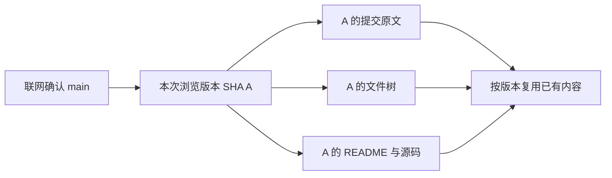

# 按数据类型设计的缓存策略

共享发布：2026-10-21；方案整理：2026-10-20。状态：讨论结论与实现建议，尚未实现。本文细化[软件架构讨论稿](architecture.md)的数据层；离线阅读和联网刷新已确认，具体时间、容量、私有内容保留以及依赖选型仍待确定。本文记录方案不等于将全部建议升级为已确认要求。

## 设计原则

缓存按数据语义分类，同一个页面、同一个 API 响应中的字段也可能采用不同策略。不能统一规定“有缓存就先显示”，也不能把全部接口结果无条件写入 SQLite。

对每一种资源分别决定：

1. **存储位置**：仅内存、SQLite、磁盘文件，或根本不作为可复用缓存保存。
2. **验证条件**：打开时验证、超过一定时间后验证，或固定版本直接复用。
3. **旧值展示规则**：允许先展示、只作为明确标识的历史快照展示，或验证前不展示为当前状态。
4. **保留与失效规则**：容量淘汰、手动清理、写操作后更新/失效、账户与授权变化处理。

“已保存”不代表“仍然新鲜”；“需要验证”不代表“必须删除”。不落盘的内存数据同样可能过期。条件请求、离线快照和跨标签共享是不同能力，不应混为一种缓存策略。

## 内存、SQLite 与磁盘文件的分工

| 位置 | 主要价值 | 不承担的职责 |
| --- | --- | --- |
| 内存缓存 | 本次运行期间快速读取、多个标签共享、保留刷新期间的现有画面 | 不保证跨重启存在，也不保证内容最新 |
| SQLite 缓存表 | 保存值得跨重启保留的结构化内容、有限查询结果、离线快照和验证信息 | 不要求所有响应落盘，不用旧值证明当前状态或权限 |
| 磁盘文件缓存 | 保存头像、图片和较大正文，避免把大量二进制数据常驻内存 | 不永久保留所有历史下载，也不把临时 URL 当作内容标识 |
| 用户持久数据 | 设置、账户引用、需要时的会话记录和未来草稿 | 不属于可随意淘汰的缓存，清缓存不能删除这些数据 |

如果需求只是同一次运行中“请求返回前显示旧值”，内存就足够。SQLite 的额外价值主要是：重启/离线后仍有可读内容；跨重启保留正文及验证器，验证未变化后复用；保留列表和详情的阅读上下文。它不是每次请求的必经路径。

Stars/Forks 可随仓库摘要顺带保存，不需要独立的频繁写盘机制。Notifications 的最近内容值得保存，当前未读数需要重新验证。短暂的 CI 进度或可合并性计算结果没有明确历史阅读需求时，首版仅放内存即可。数据库任务在后台执行；不要把每次 UI 重绘或状态变化都变成一次磁盘写入。

## 按类型的初始策略

以下时间是**应用层按需验证的初始建议**，不是最终参数、固定轮询周期或 GitHub 实时性保证。超过时间通常意味着下次使用时需要验证，不意味着后台为所有资源定时发请求。具体端点支持、服务端缓存约束、轮询间隔与限流优先于这些建议。

| 数据 | 存储建议 | 在线读取和刷新 | 旧值与离线行为 |
| --- | --- | --- | --- |
| 分支最新 SHA、latest commit 指向 | 内存管理当前结果；磁盘仅保留上次浏览版本快照 | 进入仓库、切换分支、主动刷新时验证；普通重绘不触发请求 | 未验证前不将旧值称为“最新”；离线显示上次浏览的提交 |
| 固定 SHA 的原始 commit message、作者原始字段、父提交关系 | SQLite | 按仓库与 SHA 命中后直接复用，不按时间刷新原始对象 | 保留至容量淘汰或清理；GitHub 关联用户等扩展字段另行验证 |
| 固定版本的文件树、README、源码 | 树/索引存 SQLite；正文按大小放数据库或文件 | 按 commit/tree/blob SHA 复用，先明确当前浏览版本 | 可离线读已缓存版本，不假装它仍是当前分支最新内容 |
| 用户和组织头像 | 图片落盘，元数据存 SQLite；内存仅保留有限解码结果 | 本地优先；URL 变化时获取新图，URL 不变时也按响应规则验证；无明确规则时可暂以 24 小时为验证间隔 | 通常允许旧头像，成功获取后替换；遵守响应对存储和旧值复用的限制 |
| README 内图片 | 文件缓存 | 固定仓库版本的图片按对象复用；外部图片按自己的 HTTP 缓存规则处理 | 动态徽章不能因 README 固定就永久复用 |
| 仓库描述、Topics、用户简介等资料 | SQLite | 先展示，距验证约 15 分钟后按需后台刷新 | 可展示旧资料；本应用修改成功后立即更新或失效 |
| Stars/Forks、用户统计 | 随摘要存 SQLite，当前值驻内存 | 距验证约 5 分钟后按需刷新 | 旧数字可用于摘要，不能承诺实时；操作后的相关计数需协调更新 |
| 侧边栏和 Profile 仓库列表 | SQLite，保留查询及分页信息 | 启动展示缓存并刷新；之后约 5 分钟内可复用 | 已缓存页不等于完整仓库列表 |
| Home 最近参与 Issues/PRs、Feed | SQLite，有限页数 | 约 1～2 分钟后按需刷新；支持手动刷新 | 可先展示旧列表，按稳定 ID 合并和排序；接口本身也可能延迟 |
| Issue/PR 正文与评论 | SQLite | 先展示已有内容，进入详情时验证 | 支持离线阅读；评论可能编辑或删除，不能按“历史内容”永久不刷新 |
| Issue/PR 状态、审批、CI、部署状态 | 当前状态以内存为主；只在有明确阅读价值时保存快照 | 打开对应页面时验证；持续观察的运行状态才考虑受控前台轮询 | 保留的旧结果标识为上次状态，不作为当前操作依据 |
| Notifications 列表 | SQLite 保存最近内容与上次同步状态 | 当前账户集中刷新，按接口验证器和允许的轮询间隔调度 | 重启/离线可读之前的通知；并非完整历史镜像 |
| Notifications 当前未读数与状态 | 内存管理当前结果；可随列表顺带保存上次状态 | 在线重新确认；标记已读成功后协调列表、计数及其他页面 | 离线只代表上次同步状态，不能表现为已确认当前未读数 |
| Releases、Packages、Environments 列表 | SQLite | 约 5 分钟后按需刷新；部署运行状态拆开处理 | 历史列表可读；“最新版本”、标签指向和可编辑元数据不能永久固定 |
| Languages、Contributors、贡献热力图 | SQLite | 约 30～60 分钟后按需刷新 | 可先展示旧统计，历史日期的统计也不认定绝对不可变 |
| 搜索结果 | 首版仅有界内存 | 相同查询约 30 秒内复用；查询变化重新搜索 | 不默认落盘保存所有搜索结果，离线不冒充完成了实时搜索 |
| 权限、可合并性、管理操作资格 | 内存短期提示 | 打开相关操作时检查；实际写操作由服务端最终判定 | 缓存只能辅助界面，不能证明当前仍可写入或合并 |

头像缓存建议保存原 URL、尺寸、验证器、验证时间和本地文件位置。同一 URL 也可能更换图片；磁盘保存文件，内存的解码图像/GPU 资源独立按预算释放。响应中的 `no-store` 等限制必须遵守，不能为上述时间建议强行落盘。[HTTP 缓存规范](https://www.rfc-editor.org/rfc/rfc9111.html)

## Latest commit 与文件版本一致性

“最新提交”需要拆为两种数据：

```text
main → abc123                         可变的分支指向，需要联网验证
abc123 → "Fix sidebar scrolling"      固定提交的原始消息，可以长期缓存
```

重新进入仓库时确认分支指向。若仍为 abc123，复用其消息和已缓存对象；若变为 def456，加载新版本需要的内容。这里的“每次验证”针对进入/刷新等业务动作，不是每一帧、每一个控件各发请求；相同在途读取可以合并。

Git commit、tree、blob 按内容标识。长期复用限于固定对象的原始内容，不能把包含关联 GitHub 用户、权限、检查状态等扩展字段的整个 API 响应都视为不可变。[Git 对象说明](https://git-scm.com/book/en/v2/Git-Internals-Git-Objects)



同一文件区域以同一提交快照为基准，避免顶部消息来自 B、树和正文仍被表示为 B 但实际来自 A。发现新版本后协调切换内容；加载期间也可保留明确标识的旧快照。

文件行的“最近一次修改提交”不同于分支 HEAD，应按仓库、所选提交 SHA、路径与查询语义缓存。HEAD 变化后按需重查，避免为所有文件、所有仓库无条件展开请求。

固定提交下“没有 README”可以随该 SHA 缓存；分支产生新版本后重新判断。权限不足导致的 404 不能缓存成“仓库永久不存在”。PR 的 head SHA 不变，也不代表审批、CI、评论或可合并性没有变化。

## 验证、调度与分页

支持条件请求的 REST 端点可以保存 `ETag` / `Last-Modified`。返回 `304` 时复用对应原始表示，更新验证时间；返回新内容时更新内容与验证器。验证器属于具体请求表示，必须与相同账户/授权、端点、参数及媒体类型匹配，不能拿详情响应的验证器验证另一个列表。不能默认把同一机制套到所有 GraphQL 查询。

GitHub 说明，正确携带授权且返回 `304` 的条件请求不消耗主限额；这不等于无限请求，仍需控制调度和 secondary rate limits。图片下载等不同服务也不能直接套用这条 API 限额规则。[REST 最佳实践](https://docs.github.com/en/rest/using-the-rest-api/best-practices-for-using-the-rest-api)

刷新触发包括进入页面、切换分支、恢复联网、手动刷新和相关写入成功。窗口重新获得焦点可按资源策略及上次验证时间安排刷新，不能把每次焦点事件当作全量同步。首轮只对有明确需求的可见 CI/部署状态开启轮询；隐藏标签和侧边栏全部仓库不各自持续轮询。

通知使用账户级任务，遵守 `X-Poll-Interval`，并按接口返回的验证器工作。[通知接口](https://docs.github.com/en/rest/activity/notifications) Feed 接口本身不保证实时，缩短本地缓存时间不能消除服务端事件延迟。[事件接口](https://docs.github.com/en/rest/activity/events)

联网恢复先处理活动页面与用户请求，再处理其他需要更新的数据；遇到限流按服务端信息等待。请求发出时固定授权上下文，切账户后不把新 token 填入旧请求。

查询结果需要保存筛选、排序、分页/游标与完整性信息。排序列表刷新时可能发生条目移动，不能把不同时刻的第一页和后续页盲目拼成完整列表；更新列表索引、按 ID 去重，并按需要使旧后续页失效。数据只缓存一页时，离线也只有这一页。

缓存文件本身，而非将临时下载地址作为永久标识。Contents API 的下载 URL 会过期，需要下载时重新获取；头像等普通图片 URL 不应因此被一概当作一次性链接。[仓库内容接口](https://docs.github.com/en/rest/repos/contents)

## 写入、共享和旧响应拦截

相同授权上下文的相同资源/查询共享内容和在途请求，`TabId` 不属于共享数据键。页面保留独立分支、文件、筛选和滚动状态；关闭一个订阅页面不取消其他页面仍需要的读取。

写操作成功后，不等待缓存到期。例如 Star 成功后更新按钮状态，并更新或使仓库摘要、Stars 列表等相关资源失效；新评论成功后更新评论及相关摘要。没有权威返回值的计数可以触发重查，不能把本地推算当作服务端确认。

结果进入缓存前检查账户/授权上下文、资源代次和请求版本；更新页面前再检查目标标签及其当前资源。写入成功或失效时推进本地资源版本，阻止更早发出的读取覆盖较新的结果。

首轮远程写操作要求在线，不实现离线自动重放。写操作超时可能发生在服务端已经执行之后，应核对结果，不能无条件重复发送。

## 离线、授权与清理

离线仅展示已获取且保留策略允许的内容，并区分上次同步时间、历史版本、部分列表和未缓存状态。无缓存不是服务端无资源；认证失败、权限变化、资源不可见与网络离线是不同错误。

私有缓存按 host、稳定账户 ID 与授权上下文隔离。固定 SHA 的内容虽然不变，也不自动意味着任何账户都能读取。明确授权失效后能否继续展示历史私有内容、移除账户后的保留/删除规则仍待确定，不能默认把权限拒绝当作普通断网继续读。

验证间隔与磁盘保留期限分开。容量淘汰或手动清理删除可重取副本；释放内存不必同时删除磁盘。清缓存不删除设置、账户引用、用户选择保留的会话记录或未来草稿。凭据保存在系统凭据设施，不进入普通缓存表或文件。

## 实现接口与待验证事项

在统一数据入口中，为资源类型声明存储位置、验证触发、旧值展示、保留范围及关联失效规则即可，首版不需要复杂规则引擎。页面请求应用模型，不自己决定 SQL、下载或每种 API 的 TTL；缓存键与验证元数据由数据层管理。

尚待确定：各类验证间隔的实测取值、前台轮询预算、内存/磁盘容量与淘汰规则、通知保留范围、私有内容策略、账号移除行为，以及 SQLite/文件的具体实现。

后续验证至少覆盖：

- 重启离线仍能读已缓存内容，未读数和 latest 不被误标为当前已确认状态。
- main 指向不变时复用原始内容；变化时文件树、正文与提交说明版本一致。
- 同一头像 URL 内容变化时最终替换，长列表解码资源受控。
- 写入后旧请求不覆盖新值；关闭/切换标签、切账户不写错缓存或页面。
- 分页刷新不把部分或混合版本列表表示成完整结果。
- 清缓存不损失持久用户数据；无明确持久价值的瞬态状态不频繁落盘。

## 早期流程图的适用范围

本地忽略目录中的早期缓存流程图及验证产物保留了多标签共享、响应检查、账户隔离和淘汰场景。它早于本次按类型细化，其中“先展示旧值”的读取路径只适用于允许该行为的资源，不能覆盖本文件关于 latest、权限和当前未读状态的要求。
