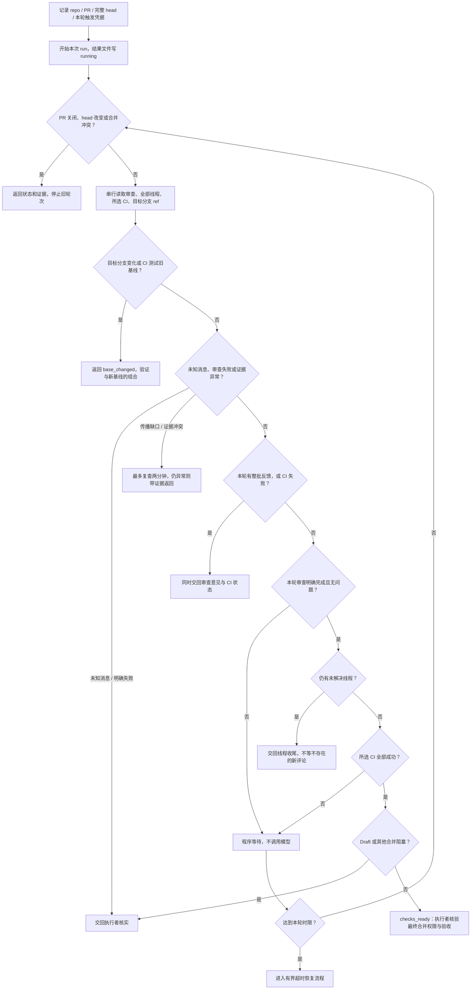
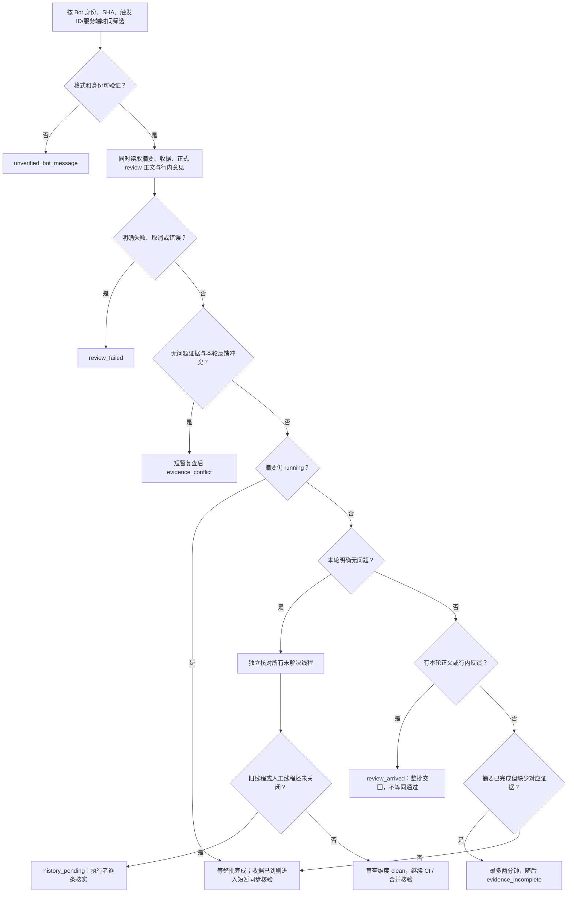
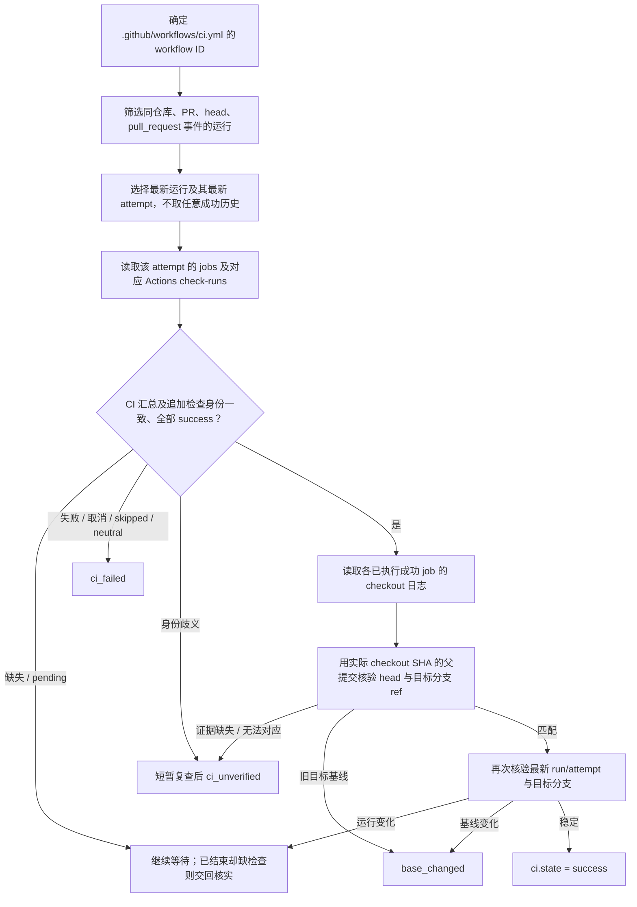
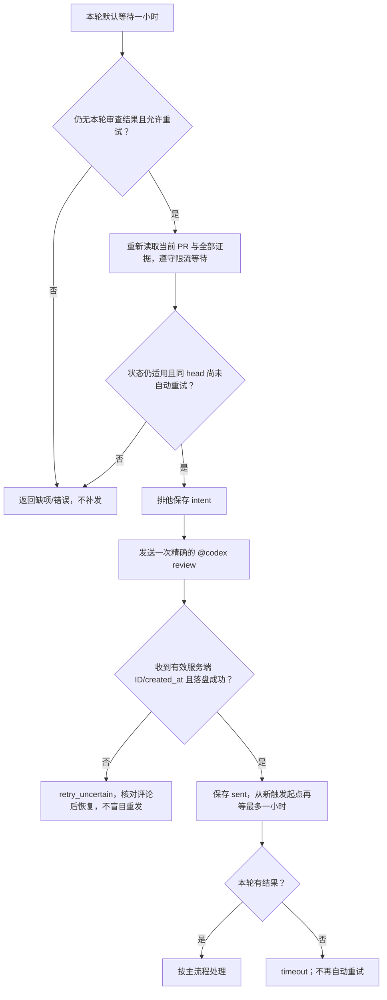

# PR 审查与等待流程

这是已确认工作流的可执行约定，适用于主 Agent 和任务执行者。脚本收集事实，执行者处理代码、线程与权限；合并仍遵守 [Agent 工作流](agent-workflow.md#合并前的门槛)。2026-10-25 的完整重构包含此前流程图的判断，以及后来增加的一小时后单次重试。

## 主流程

各维度分别保留。比如本轮有反馈且 CI 失败，返回整批反馈同时附 `ci.state=failed`，执行者一次处理两类问题。图中的分支不是“找到一种问题便丢弃其他证据”；遇到 head/关闭/冲突才停止沿用旧批次。

代码的返回优先级：head/关闭/冲突与目标分支变化 → 新触发轮次 → 未知 Bot 信息/审查失败 → 本轮反馈 → CI 失败 → 证据冲突/缺失 → CI 旧基线/无法验证 → 线程收尾 → CI 等待 → 合并阻塞/最终核验。即使同时命中多个条件，已收集的 review、threads、ci、integration 与 next_actions 一并返回。

## 本轮审查与历史线程

- 识别的可信无问题收据，或已完成且无未解决 findings 的可信摘要，可构成本轮 clean 证据；同时核对本轮正式 reviews，不能只看摘要的 Completed。
- `has_unresolved_findings=true` 可能包含旧线程。出现可信本轮 clean 收据且无本轮冲突时，旧线程作为独立待办，不能继续等“新行内评论”。PR #14 的故障场景由回归测试覆盖。
- 纯正文反馈同样交回。只有正式 APPROVED/COMMENTED、空正文、没有评论或退出码 0 都不自动推导项目通过。
- 有 running 摘要时先等整批完成，避免首条反馈截断一轮；完成后的缺口和矛盾最多等待 120 秒（受总预算限制），可用 `--evidence-grace-seconds` 调整。单次诊断直接返回异常证据。
- GraphQL 分页获取线程 resolved/outdated，REST 分页补齐正文和回复。保留人工回复；outdated 不等于 resolved。无法关联线程根时明确返回证据缺口。

执行者收到线程待办后，核对当前代码、修复提交及完整讨论。已解决且没有争议的线程可以通过 `gh` 调用 GitHub 的 `resolveReviewThread` 收尾，并保存处理依据；禁止盲目批量 resolve。仍成立的问题按修复循环处理；误报、冲突或新取舍按永久裁决记录交负责人/主 Agent。只关闭已核实线程、没有新提交时，使用原 head/触发凭据重新只读核验，不为线程收尾重复触发审查。脚本本身不 resolve、不改代码、不合并。

## CI 与集成核验

`CI` 永远在所需检查集合里；`--check NAME` 只能追加当前 CI workflow 内的检查，不能替换 CI。其他 workflow 的门槛不由这个参数隐式信任。检查绑定 GitHub Actions App、check suite、job、run、attempt、PR 和完整 head。同名歧义不猜测；旧成功不能覆盖新 pending/failed。

不能把 PR 响应里的 `base.sha` 当作目标分支实时 HEAD：真实 PR #17 验证已观察到它滞后。脚本开始和结束时读取目标分支 `git/ref/heads/...`，并与 CI 实际 checkout 的临时 merge 提交父节点比较。checkout 日志不可读取、格式变化、jobs 测试不同 revision，或无法证明测试组合时交回核实。正常文档任务被策略允许的上游 skipped 不参与 checkout 核验，但汇总 CI 必须 success。

`checks_ready` 只代表已收集维度齐备，不授权合并。执行者仍需核对完整裁决历史、负责人 UI 验收、milestone、最新分支保护及当前 head，并按工作流使用 squash merge 和 GitHub 默认消息。

## 一小时超时恢复

已有审查完成、CI 单独等待、旧线程/证据待处理、明确错误/未知消息、新触发、关闭/冲突/head 或基线变化，都不属于“无结果恢复”。重试日志按同一任务 repo/PR/head 保存，重启不重置第二轮期限；跨状态文件/机器不是全局锁。`--timeout-seconds 0` 和 `--auto-retry false` 禁止自动评论。

同 SHA 的摘要没有唯一 run ID。新触发 ID/服务端时间可以排除之前可见的证据，不能证明晚到的旧运行属于新运行。发现重叠或矛盾须核实，不以重试绕过审查。

## 返回与调用约定

结果 schema 2 使用本次 `run_id`，包含 `review`、`threads`、`ci`、`integration`、`next_actions` 及已读取的证据；早期关闭/head 变化、参数或权限错误可能尚无完整维度。评论只保留必要身份、时间、位置与完整正文，不回传无关用户/API 元数据。

| 状态 | 退出码 | 下一步 |
| --- | --- | --- |
| review_arrived | 0 | 按共享工作流分类整批正文/行内问题，同时处理 CI 状态 |
| review_completed | 0 | 审查与线程维度已就绪，未请求 CI；继续合并门槛核验 |
| checks_ready | 0 | 进行最终权限、验收、保护及 SHA 核验，非自动批准 |
| timeout | 2 | 读取 waiting_on/last_error/retry，报告缺项 |
| head_changed / pr_closed | 3 / 4 | 停止旧轮次 |
| unverified_bot_message | 5 | 核实错误、身份或未知格式 |
| ci_failed / review_failed | 6 / 7 | 修复或排查，不能当通过 |
| merge_conflict | 8 | 解决冲突后对新 head 走完整循环 |
| retry_uncertain | 9 | 保留意图，核对 GitHub 实际评论，不重发 |
| history_pending | 10 | 核对并收尾未解决历史/人工线程，争议走裁决 |
| evidence_incomplete / evidence_conflict | 11 / 12 | 短暂复查后仍有缺口/矛盾，交回证据 |
| base_changed | 13 | 验证与新目标基线的组合；有新提交则重新 CI/review |
| ci_unverified | 14 | workflow/run/check/checkout 证据无法唯一核验 |
| merge_blocked | 15 | Draft、保护或未知 mergeability 仍阻塞，核实后重新检查 |
| trigger_changed | 16 | 核对新的触发评论并改用对应服务端游标 |
| error / interrupted | 1 / 130 | 明确错误/取消，不算成功 |

每次 CLI 先用新 run_id 写 `running` 使旧成功失效，随后所有正常、错误、取消路径原子保存最终结果；参数错误也在可安全确定的 `--out` 路径更新结果。结果路径不能覆盖 retry journal；路径不明、不可写时 stdout 明确报错，调用方不得退回信任旧文件。调用方同时核对本次 run_id/head/status、退出码和完整 JSON，不用 `| tail` 或后续 echo 的退出码代替脚本原始结果。

轮询默认 30 秒，正常间隔遵从配置；错误指数退避并尊重 Retry-After / X-RateLimit-Reset，总期限先到则带缺项退出，不提前请求。GET 使用内存 ETag 条件请求并逐页核验，状态变化时才更新简短进度；GraphQL 和证据核验不假定永久缓存有效。脚本仍是前台程序，没有后台唤醒服务。

实现入口：[等待循环](../.agents/skills/githux-pr-review/scripts/wait-review.mjs)、[审查判定](../.agents/skills/githux-pr-review/scripts/review-state.mjs)、[CI 判定](../.agents/skills/githux-pr-review/scripts/ci-evidence.mjs)、[GitHub 适配器](../.agents/skills/githux-pr-review/scripts/github-api.mjs)。运行步骤见 [skill](../.agents/skills/githux-pr-review/SKILL.md)。