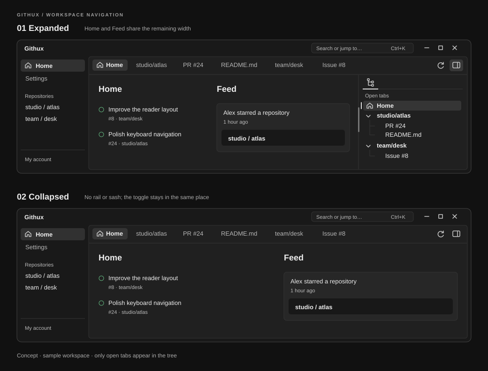

# 右侧栏：用树切换已打开的标签

设计稿 · 2026-11-24。目标场景：同时阅读几个仓库的 PR、Issue 和文件时，顶部标签可能滚出视野；知道「在哪个仓库」就能从右侧找到原来的标签。左栏继续用于发现和打开资源。此稿只规划设计，交付批次未定。

**开关建议：应用标签栏最右，紧跟刷新。** 使用「矩形右侧带分隔线」的 ghost 图标；打开时显示选中底色，两态分别提供“展开右侧栏”或“收起右侧栏”的提示与可访问名称。这个位置已在标签横向滚动区外，右栏开合、标签溢出或刷新图标转动时都不移动。备选为标题栏搜索框左侧；只有在窄窗下标签工具栏确实放不下时才考虑，避免与搜索或窗口按钮竞争。不在 sash 中间放按钮。

**面板形态。** 建议首次默认收起，展开宽度先试 280 logical px，下次展开恢复本窗口上次手调宽度。宽屏时 Home 和 Feed 共用剩余空间。窄窗先限制右栏宽度，若留不出可读正文，建议临时覆盖在内容右侧（仍可用同一开关收起）；具体断点由 880px 最小窗和实机对照决定。完全收起意味着宽度为零，不留图标轨、分隔缝、透明拖拽热区或键盘停靠点。

**动效。** 宽度沿用[左栏](sidebar-layout.md)的展开/收起过渡；右栏左缘使用相同圆头 resize sash，向左拖变宽，向右拖变窄。快速反向时从当前画面继续。切换树中活动标签时，仅行的背景块平滑移动，细 indicator 立即换行；减少动态效果时直接到终态。两侧各自保存宽度和滚动，不联动收起。右栏顶部的小 tab bar 只放图标，同时提供 tooltip 与可访问名；当前只画标签树一个入口。

**树怎样对应顶部标签：**

- 树只读取[当前工作区](../src/workspace/mod.rs)的会话；按同一个稳定 `TabId` 激活，不重开页面、不额外请求 GitHub。树最多两层。第一层直接列完整的 `owner/repo`，同一所有者的多个仓库也并列；Home、用户主页、Settings、Notifications 等无仓库归属的标签是同层叶子。第二层平铺该仓库已打开的 Issue、PR、文件。文件路径用文本区分，不展开目录；也不添加所有者或资源类型这一级。
- 箭头只折叠/展开分组。若仓库本身也已开为标签，点仓库名切换到它；没有对应标签时，这行只做分组。组内保留顶部相对顺序，组按最先出现的成员排列；不会反过来重排顶部标签。文件目前是仓库页内选中项，不因为读过就出现在树里；图中的独立文件与单条 Issue 标签是后续路由示意。
- 从顶部、树或 `Ctrl+Tab` 切换时，两处同时指向同一页；新的活动项若藏在折叠组内，展开所属仓库并滚到可见。手动收起组不改变活动页、不在下一次重绘时强制展开。开关只改变布局；在面板内收起时焦点回到开关。关闭标签后沿用工作区原有邻居规则，仓库标签及其最后一个子项都关闭后才移除该行；切账户只展示新工作区的树。

**实机验收场景。** 同时打开同一所有者的两个仓库、用户主页和多个资源标签，确认仓库行与用户主页并列，带目录的文件也只缩进一次，先从树选一条已滚出顶栏的 PR，再用键盘切回 Home；两处高亮和原有页面位置都应正确。拖宽、快速开合、在最小窗口及 reduced-motion 下重复操作，确认没有不可见热区或被挤没的正文。其他视图做什么、是否允许只显示树并隐藏顶栏，留待后续讨论；本稿保留顶栏。
