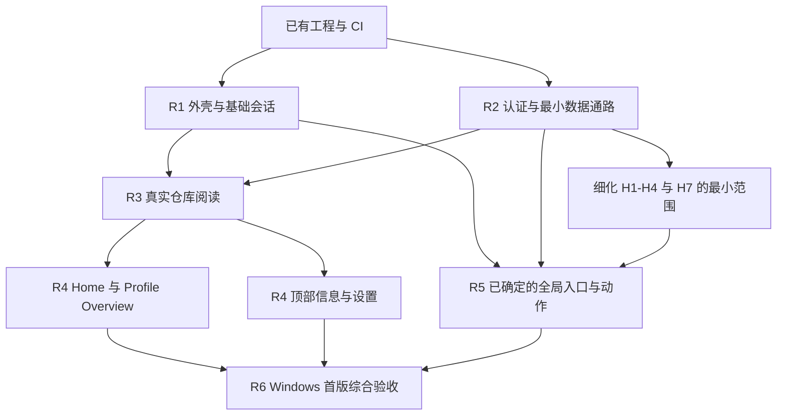

# 开发路线图

更新：2026-10-29。**首版功能取舍已确认；本文的开发顺序和任务拆分为讨论稿。** 外壳、真实账户/仓库侧栏及多个数据/UI 组件已合并；正式 Home/Profile/统一 Repository 页面接线仍未完成，业务内容离线缓存和最终 Settings 设计也未完成。本文不承诺日期，也不把路线图中的建议变成已批准的产品细节。

功能范围以 [产品约定](product.md#首版范围) 为准；状态边界、数据策略及交付规则分别见 [架构方案](architecture.md)、[缓存策略](cache-strategy.md)、[Agent 工作流](agent-workflow.md)。路线图只维护顺序、依赖和完成标准，不复制另一套产品规则。

已确认的首版功能及其直接配套工作统一归入 [First Release（milestone #1）](https://github.com/nocpiun/githux/milestone/1)，相关 PR 创建时必须关联该 milestone，操作与核验见 [首版 Milestone](agent-workflow.md#首版-milestone)。它用于进度归集，各 PR 仍独立验收与合并。

## 首版要到达的位置

做出可以实际使用的 **Windows GitHub 桌面客户端**：启动 Home，通过固定侧边栏与基础多标签访问仓库、个人主页和设置；仓库能读取真实分支、文件与 README，在紧凑摘要区展示 Releases、Contributors，并在页面底边展示 Languages；Profile Overview 包含个人 README、Pinned/Popular Repos 和贡献热力图；支持安全登录、多账户保存但单账户活动，以及已缓存内容的离线阅读。

Notifications、全局 Issues/PRs、New 和远程写操作保留为待细化范围，须逐项确定最小功能。它们不是被自动排除的功能，也不能由执行者自由扩成完整 GitHub 功能集。

本轮不建设 Packages、Environments、Contribution Activity、Profile 其他 Tabs、标签进阶操作、安装更新系统或 macOS/Linux 产品适配。Issue/PR 详情和仓库其他未设计 Tabs 继续按产品约定留空。保留既有四平台 Debug 编译与 artifact，不把编译通过称为跨平台产品支持。

## 当前证据与下一步

本节只把 **main `730d2292dcd5bb981928341259c971e42ff497b5`**（[PR #38](https://github.com/nocpiun/githux/pull/38)，2026-10-29）及此前已合并 PR 作为“当前已实现”的事实来源；并行任务仅在明确标注时称为已派发/进行中，不读取其他工作树或把未来结果写成 main 事实。

| 能力 | 已合并与源码证据 | 正式接线 / 原生验证边界 |
| --- | --- | --- |
| 正式 Rust / GPUI / Ely 外壳 | 单 Cargo package、固定依赖；[`app::run`](../src/app/mod.rs)、[`ui::Shell`](../src/ui/mod.rs) 与 workspace 标签已存在 | 窗口拖动、双击最大化、贴靠、Tall 标题栏等已有各自原生证据，见[外壳记录](devlog/2026-10-22-shell-layout.md)与 [Tall 记录](devlog/2026-10-23-tall-caption.md)。多标签完整交互、中文 IME、多 DPI/跨屏和字体回退仍待整体验收 |
| 真实账户、仓库侧栏与每账户工作区 | PR #38 已合并；[`app::accounts`](../src/app/accounts/mod.rs)、[`storage::accounts`](../src/storage/accounts.rs) 接入正式 Shell。真实 `/user/repos` 自动读取、独立账户标签、真实圆头像、空 mask 防护和头像有限总超时已实现 | Settings › Accounts 是过渡入口，不是最终 Settings 设计。真实 PAT 登录、Settings/footer 同屏交互、部分原生滚动手感与多 DPI 产品路径仍待验收，见[account-shell 记录](devlog/2026-10-28-account-shell.md) |
| Home / Feed | [PR #34](https://github.com/nocpiun/githux/pull/34) 的 `src/ui/home/**` 与账户作用域 page-data 已合并；无时间窗口 `involves` / updated 降序、Feed 服务顺序与手动刷新已确认 | **正式路由未接入**：[`ui::page`](../src/ui/page.rs) 仍画 fixture。独立 example 的视觉探针不等于正式 Home、真实数据或原生交互验收；由 shell-pages 接 HomeView + adapter |
| Profile Overview | [PR #36](https://github.com/nocpiun/githux/pull/36) 的 `src/ui/profile/**`、公开资料/pins/贡献读取及 Profile README helper 已合并 | **正式路由未接入**：当前只画活动账户 identifier stub。shell-pages 需接目标用户、公开同名根 README、最近一年 range、pins/gist/Popular 语义及导航；原生产品路径仍待验收 |
| 统一 Repository browser + overview + reader | [PR #35](https://github.com/nocpiun/githux/pull/35) 已合并统一页面；原独立 overview PR #37 已关闭、没有另行合入第二套页面。固定版本 tree/blob、Markdown/source reader 与 Releases/Contributors/底边 Languages 已在组件内组合 | **正式路由未接入**：当前 Repository 仍是 identifier stub。shell-pages 需复用 activate/deactivate/rebind 与账户上下文；Star/Fork 只有宿主动作请求，没有真实写操作。example 的原生消息/截图不替代正式应用验收 |
| 账户持久化与业务缓存 | PR #18、#38 的 rusqlite 账户目录和系统凭据引用真实存在；[`content`](../src/content/mod.rs) 有正文准备 | **没有业务内容磁盘缓存或重启离线内容阅读**。账户 SQLite 不能算作内容缓存；workspace 按已确认范围仅内存、重启 Home，不是待补持久化。私有内容保留政策、容量/TTL/调度参数待决定后按链路实现 |
| CI 与交付流程 | PR #1/#2 起已有检查；PR #7 起 Ubuntu code-check，四平台 Debug build 与最终 `CI` 汇总保留；PR #31 增加 PR Check 门槛 | 具体 required checks 和当前 head 结果必须到 GitHub 核验；编译通过不是 Windows 以外原生产品支持，也不是 GUI 验收 |
| Agent 协作 | 独立任务、可见执行会话、PR 与审查循环已有实际使用 | 派发 skill 和完整并行调度未产品化；并行工作不能成为 main 的实现证据 |

### 下一步依赖（当前排期，不新增产品授权）

1. **shell-pages 正式接线是当前首要工作**：复用已验收的 HomeView、ProfileView、统一 RepositoryPage 和 page-data/account services，替换正式 `ui::page.rs` 的 fixture/stubs，处理账户切换、activate/deactivate/rebind、typed 导航与每会话生命周期。完成标准必须来自正式产品路由，不能由 examples 推断。
2. **Settings 独立设计与验收**：过渡 Accounts 功能可继续服务开发，但最终页面不能直接沿用。先确认全局/仓库分类与首批项目，再实现本地设置持久化；local-only 提案未获批准，不是接线依赖或共享规则。
3. **持久业务内容缓存与离线**：在私有内容授权失效/账户移除政策及必要缓存参数明确后，按仓库、Home/Profile 等数据类型实现磁盘快照、验证和清理。它与内存 workspace 恢复、账户目录持久化是不同工作。
4. **README 图片与资源链路**：reader 当前不下载网络/相对图片；需固定版本、安全来源与资源缓存边界，不能把图片提示算作完整 README 阅读。
5. **输入、DPI 与首版整体验收**：在正式接线后的真实 Windows 窗口核验中文 IME、文本选择、键盘/焦点、触控板/滚动、多 DPI/跨屏、长内容和账户切换。各组件已有的局部原生证据保留，但不代替端到端验收。
6. **保留首版剩余范围**：H1–H4/H7、command palette 搜索范围及最终 Settings 项目仍待逐项决定；Issue/PR 详情等已排除/留空项不借接线恢复。持久缓存、图片、全局入口和综合验收未做完前，不能宣布首版完成。

已有 CI 的分支规则是否启用，以仓库实际设置为准。路线图不替负责人修改规则。负责人已于 2026-10-22 解除首次试跑的单实现者限制，并明确按依赖、文件冲突、编译资源与审查积压安排并行；这不改变同一任务同一时刻只有一个有效写入者的要求。

## 推进方式

建议先打通一条真实仓库阅读链路，再扩展页面。外壳验证与 API/认证核验可以按依赖分别推进；数据模型从第一次请求就携带账户和资源版本，不留到所有页面完成后返工。

下面的 R1–R6 表示能力顺序，不是必须整批完成才能合并的里程碑。每项可拆成多个小 PR，完成验收后直接合入 main；没有依赖的任务无需等待同一行其他工作。负责人已解除首次试跑的单实现者限制，当前按依赖、文件冲突、编译资源与审查积压安排并行，不固定 Agent 总数。

R4 各页面可以独立交付；R5 不依赖所有 R4 页面完成。若具体动作涉及某页面或数据类型，只增加那一项依赖。缓存、输入、性能和诊断随各条链路交付，R6 是整体验证，不是第一次处理这些问题。

## R1：外壳与基础会话

**目标：** 用确定性假数据验证真正的桌面交互，而不先铺满所有业务页面。

- 实现 Windows 自定义标题栏、island、固定导航和仓库 group 的有界独立滚动；复用 Ely 主题与组件组合。**已交付**：见[外壳布局开发日志](devlog/2026-10-22-shell-layout.md)。侧栏受限 resize、收起图标栏/底部菜单、行外活动线与间距调整已合并；当时的审查/验收记录见[侧栏开发日志](devlog/2026-10-25-sidebar-layout.md)，剩余原生交互统一列入 R6，不把历史 PR 的“禁止自动合并”当作当前状态。
- 建立路由、`TabId` 与页面局部状态。先支持打开、切换和关闭；仓库分支/文件、Profile 页面和各自滚动与焦点互不串用。应用会话标签与页内内容 Tabs 分离。**已实现**：`workspace::Workspace` 持有有序会话集合、活动标签与每标签的滚动/焦点/仓库会话状态，打开/复用/切换/关闭、标签条水平滚动与中键关闭见 [基础标签规则](product.md#外壳与导航) 和 [开发日志](devlog/2026-10-23-workspace-tabs.md)；**真实窗口人工验收待完成**。拖拽排序、hover 显示关闭按钮与右侧固定工具栏已按 2026-10-25 反馈实现，同样待人工验收。

- 放置右上角 command palette 入口和底部四入口，先完成焦点、弹出/关闭和路由约定。具体搜索结果由后续选定范围接入。**入口、本地导航结果、焦点返回已交付**；真实搜索范围未接入。
- 首次接入文本输入与阅读控件时验证中文 IME、选择复制、字形回退和 DPI。原型补丁先重现再决定是否采用，不默认整体搬入正式工程。**首次文本输入已出现**；组合态逻辑有测试平台用例，真实 IME 与多 DPI 仍待人工验收。
- 形成最小共享组合：仓库行、元信息、设置行与页面状态显示。由实际复用产生组件，不预建庞大通用 UI 框架。**仓库行、页面外壳与过渡 Accounts 设置行已产生**；更多正式页面状态随 shell-pages 接线，最终设置分类仍待设计。

**验收：** 启动 Home；侧边栏只有仓库区域滚动；能同时打开仓库 A/B 与 Profile 并保持各自状态；窗口拖动、最大化、贴靠、键盘焦点与中文候选确认正常；未设计的详情内容仍留空。

**当前状态：** 启动 Home、只有仓库区域滚动、窗口拖动/最大化/贴靠、键盘焦点与留空页面已在本机真实窗口核验；同时打开仓库 A/B 与 Profile 并保持各自滚动/焦点/仓库会话状态已由 GPUI 测试平台覆盖，但**真实窗口多标签交互与中文候选确认仍待负责人验收**，因此 R1 不能标记完成。

**已确认（负责人 2026-10-23，2026-10-25 修订）：** 基础标签的打开/复用与关闭规则、Home/Settings/全局占位页按路由单例、关闭最后标签回到 Home、最小窗口 880×560 见 [基础标签规则](product.md#外壳与导航)。标签数量不设上限，溢出改用标签条水平滚动（含细的半透明可拖动滚动条、Shift+滚轮与原生水平滚动），取代此前 8 标签预览上限与该条 H6 排除；2026-10-25 又确认了标签拖拽排序、hover/active 才显示关闭按钮与最右侧固定工具栏（先只放禁用的刷新入口），这些也从 H6 排除中移出。H6 其余项（专门溢出菜单、固定标签、拖出新窗口、导航历史、重启恢复）仍排除。账户切换时标签如何处理已于 2026-10-28 确认：每个账户拥有独立标签集合，切回恢复该账户标签；这是进程内内存状态，重启仍从 Home 开始（见 [产品约定](product.md#外壳与导航)）。

## R2：认证与最小数据通路

**目标：** 确认真实数据能按约定安全、可取消地进入 GPUI，建立 R3 必需的最小服务。

- [API 能力表](github-api-capabilities.md) 已由 PR #6 交付，作为接口/权限/分页/缺失情形和刷新限制的输入；研究结果不等于真实集成验证。无法覆盖的需求交回讨论，不悄悄改用网页 Cookie 或内部端点。
- 按已确认的 [PAT 产品登录方案](product.md#登录与未来写能力) 接入 Classic PAT，引导创建、验证身份与权限、系统凭据保存和替换；不建设认证后端。当前先读取，服务边界保留未来写操作的权限判断和写后缓存失效，具体动作另行细化。
- 实现账户元数据、平台凭据引用、活动账户上下文和切换失效机制。多账户保存、单账户活动是基线；不在 UI 或普通数据库保存 token。
- 验证后台执行与 GPUI 的桥接、取消、应用关闭、超时、重试及限流反馈。实际已选 reqwest + Tokio 与 rusqlite 账户目录；具体缓存实现和参数不因这些选型自动确定。
- 建立最小存储版本、可清缓存与用户数据分区、脱敏日志和错误分类。首先只落地仓库链路需要的数据，不一次实现缓存表中所有资源。

**验收：** 应用可识别授权账户并读取最小仓库数据；令牌失效、权限不足、断网和限流不会被显示成有效空列表；切换账户后旧响应不写入新账户的缓存或页面；关闭应用不遗留无归属工作，日志不含凭据。

**当前状态：** 账户目录、系统凭据、真实账户/仓库读取、自动加载和正式 Shell 控制器已由 PR #18/#28/#38 合并；不再描述为“UI 未接入”或“账户元数据未落盘”。每账户 workspace 也已接入。业务内容缓存仍不在这些交付内，真实 PAT 与部分原生交互验收边界见[当前证据表](#当前证据与下一步)。

**已确认：** PAT 为产品登录方式，仓库范围为当前授权下 `/user/repos` 的完整分页可见集合。

**已决定：** 账户切换时的标签处理（每账户独立标签，2026-10-28）。**进入相关实现前仍需决定：** PAT 引导的最小权限清单、授权失效和移除账户后的私有内容策略。特别是私有内容落盘前，必须明确其保留规则。

## R3：完整的真实仓库阅读链路

**目标：** 登录后能从仓库列表进入仓库，选择分支和文件并阅读内容；中间交付也保持启动 Home 的约定。

- 接入完整可分页的仓库列表、namespace 头像、仓库资料和统计；明确已加载页与完整集合的区别。
- 从分支解析本次浏览的提交版本，使提交说明、文件树和正文对应同一快照；不同标签的浏览选择独立，共享可复用数据。
- 实现 README 默认发现、Markdown 阅读、只读源码查看、选择复制及相对资源解析；验证图片和长内容，不从简单样例推断完整 Markdown 覆盖。
- 覆盖空仓库、没有 README、缺失/不可见文件、非文本或过大内容的边界。具体呈现与读取上限在任务规格中选定。
- 按 [缓存策略](cache-strategy.md) 实现这条链路的结构化快照、固定版本内容和头像磁盘缓存；latest 在确认前不冒充当前最新值。

**验收：** 两个仓库标签可以独立切换分支和文件；快速切换时旧响应不覆盖新页面；关闭一个标签不误取消其他标签共享的读取；重新启动后离线可读之前缓存的仓库内容，但不恢复旧标签集合，仍先进入 Home；无缓存、旧版本与真实空数据可区分。

**当前状态：** 低层固定快照读取、账户作用域 session、reader 和统一 RepositoryPage（含 overview）已合并，但正式 Shell 仍由 shell-pages 接线；磁盘快照、头像/正文磁盘缓存与重启离线阅读尚未实现。因此不能把 PR #35 的独立 example 称为 R3 整条链路完成。

**首个内部自用检查点：** 此链路通过后即可试用仓库阅读，收集真实数据、输入与性能问题；它不代表已完成包含 Home、Profile 等内容的整个首版，也不自动缩减其他保留功能。

## R4：扩展保留的页面和仓库信息

基础账户、查询模型和阅读器可用后，下列任务按接口依赖独立推进。

| 任务 | 范围 | 主要验收 |
| --- | --- | --- |
| Home | 左栏标题 Home：最近参与且有更新的 Issues/PRs；右栏标题 Feed：关注动态 | 依据 [数据范围](product.md#home-与-feed-的数据范围) 明确参与查询；接受 Events 延迟；分页、无活动、刷新和离线旧列表有对应状态 |
| Profile Overview | 资料、个人 README、Pinned/Popular、贡献热力图 | 本人/他人资料、无 README、无 Pinned、长内容均可读；不接入 D5 或 H5 |
| 仓库摘要与 Languages | Releases、Contributors、Languages | Releases/Contributors 在资料后的紧凑摘要区，Languages 在页面底边；窄窗口、内容为空或单项请求失败时仍能阅读文件；不请求或展示 Packages/Environments，不扩张为管理控制台 |
| 全局与仓库 Settings | 经确认的最小设置项目、统一行式风格 | 本地设置重启仍保留；区分本应用偏好与 GitHub 远端设置，不能把本地保存显示成远端成功 |
| Command palette 数据 | 经确认的搜索类别和结果路由 | 查询变化取消/淘汰旧结果；结果打开正确会话；离线不冒充已完成实时搜索 |

Feed 已选择 Events API，负责人接受其延迟；负责人 2026-10-30 确认只保留合并 PR、星标仓库、创建仓库三类活动、保持服务顺序，且每条卡片主语必须是当前账户关注的人（合并贡献取 PR 作者，需读 PR 详情确认），初始手动刷新，不自动轮询，也不承诺复刻网站全部 Feed；Follow 两类事件卡片暂缓。Home 查询为 `involves:` + `is:open`、无时间窗口、按 updated 降序；Profile 的公开同名根 README、pins/gist 提示、仅无 pin 才 Popular 与最近一年范围已确认。具体边界统一见[产品约定](product.md#home-与-feed-的数据范围)。

**当前状态：** PR #34/#35/#36 已合并三个可复用视图，PR #33 等已提供账户作用域数据接口；但正式 Home/Profile/Repository 三个产品路由仍待 shell-pages 统一接线，Settings 仍是过渡 Accounts 页面。表中“保留页面全部使用真实数据入口”的验收尚未因此完成。

**验收：** 保留页面全部使用真实数据入口，不保留假数据冒充已接入；加载、部分失败、权限不足、旧值与离线行为遵循统一约定。远端设置若包含写入，依赖 R5 选定的写操作契约，不绕开权限与失败处理。

## R5：补齐全局入口与选定动作

**状态：功能范围待细化，不能直接派发成“大而全”的协作中心。** H1–H4/H7 仍在待定范围内，先逐项确定最小目标，之后按依赖交付，不必等待所有 R4 页面。

| 项目 | 需要决定的最小范围 |
| --- | --- |
| H1 Notifications | 列表范围、未读语义、筛选、是否首版标记已读，以及条目去向 |
| H2/H3 全局 Issues/PRs | 默认查询、是否包含关闭/合并条目、筛选与分页；保持与仓库页内 Tabs 的区别 |
| H4 New | 实际可创建的资源清单、所需输入、权限与提交结果；入口存在不代表已承诺创建组织等所有动作 |
| H7 远程写操作 | 明确选哪些动作、影响哪些页面、权限与确认/失败反馈；例如 Star、标记已读只是候选，不是已批准清单 |

涉及 Issue/PR 详情编辑区的动作，与当前详情留空约定存在依赖冲突，须先重新确认设计范围，不能由执行者顺手补出详情/编辑器。列表条目在详情暂空时如何导航，也需要最小交互约定。

**写操作共同验收：** 仅按确认范围在线执行；服务端结果驱动页面和缓存更新；较旧读取不能盖掉成功写入后的状态；超时后核对是否已生效，不无条件重发。离线草稿和自动重放队列未被纳入本轮。

若这些项目未明确范围，应报告“首版范围仍待决定”，不能把整项视为已完成或暗中排除后宣布首版交付。

## R6：Windows 首版综合验收

验证完整用户路径和长期使用质量，不再新增业务范围。无需等待安装包或自动更新系统；通过当前构建和可执行文件验收。

- 从启动 Home、登录/切账户到多标签阅读、搜索、Settings、已选定的全局入口与动作，完整走通。
- 各保留数据类型验证离线/重连、权限变化、分页、刷新与缓存清理；清缓存不得删除设置或账户引用。重启可用的内容缓存与 H6 的会话恢复分开验证。
- 在真实 Windows 窗口验证多 DPI、跨屏、中文 IME、文本选择、焦点恢复、长列表、长 README、频繁切换及标签关闭后的资源释放。
- 记录启动、交互延迟、滚动、内存、图片资源、网络次数和磁盘占用的可复现条件。性能基线从 R1/R3 开始采集，再确定预算；不凭截图宣布“丝滑”，也不把 Debug 与未来其他构建模式的结果混比。
- 检查依赖/字体许可证、脱敏诊断、存储版本升级和错误后的可恢复性。H8 延后不等于可以损坏持久数据。
- 当最新提交的 CI、代码审查和相关真实交互验收均通过，并且保留项没有未决范围时，记录首版交付证据。现有合并规则按每个 PR 执行，不等到此处才开始审查。

## 任务边界与可并行部分

| 工作线 | 可以独立推进的内容 | 需要协调的交点 |
| --- | --- | --- |
| 外壳与体验 | Windows 窗口、island、基础会话、字体/IME 实验 | 路由、`TabId`、应用入口、统一主题 |
| 认证与数据 | API 能力核验、凭据、请求执行与取消、存储实验 | 账户上下文、业务模型、缓存键和错误模型 |
| 内容阅读 | Markdown/源码控件、图片与大内容边界，可先用 fixture | 固定版本资源标识、共享内容服务 |
| 页面 | Home、Profile、仓库摘要、Settings，接口稳定后分别接入 | 共享组件和领域类型，避免各页面自建网络/SQL 路径 |
| 工程支持 | 派发上下文、审查信号核验、CI 与诊断改进 | 只解决实际交付阻力，不先建设常驻调度平台 |

每个任务一个有效写入者、独立 worktree/PR。共享接口先明确最小数据与错误契约；依赖任务可以先基于 fixture 开发视图，但完成状态必须注明真实数据是否已经接入。不按阶段建立长期集成分支，不为并行而同时修改相同入口。

## 后续任务的进入条件

具体当前优先级与依赖见[下一步依赖](#下一步依赖当前排期不新增产品授权)，这里只保留进入条件，避免旧建议覆盖已交付事实：

- shell-pages 以本基线已合并组件和账户接口为输入，正式路由验证后才标记接通。
- Settings、持久缓存、README 图片分别需要自己的明确规格；未批准的 local-only 方案不自动成为依赖。
- H1–H4/H7、搜索范围和设置首批项目在相关实现前消除范围歧义；基础标签、账户切换恢复、Home/Feed/Profile 默认规则及仓库摘要位置已经确定，不重复裁决。
- 输入/DPI 与综合验收随正式链路推进，不把组件预览或 CI 当最终证据。

仍需讨论的优先决策：PAT 引导的最小权限清单、私有内容授权失效/账户移除保留政策、缓存参数、H1–H4/H7 的最小清单、首批搜索与设置项。任何一项未决都不允许执行者自行补成产品要求。

## 维护方式

范围变化先更新 [产品约定](product.md)，再调整本路线图的依赖与验收。实现结论更新对应主题及任务开发日志，引用实际 PR/源码；只有验收证据充分时才把任务标为完成。CI 构建成功、页面截图、模拟数据通过和真实产品可用分别记录。

首版结束后再按使用反馈选择后续范围：已延后的功能可以重新讨论，但不预先承诺一次性补齐。开发路线图不能替代任务授权，也不能恢复已排除的功能。
