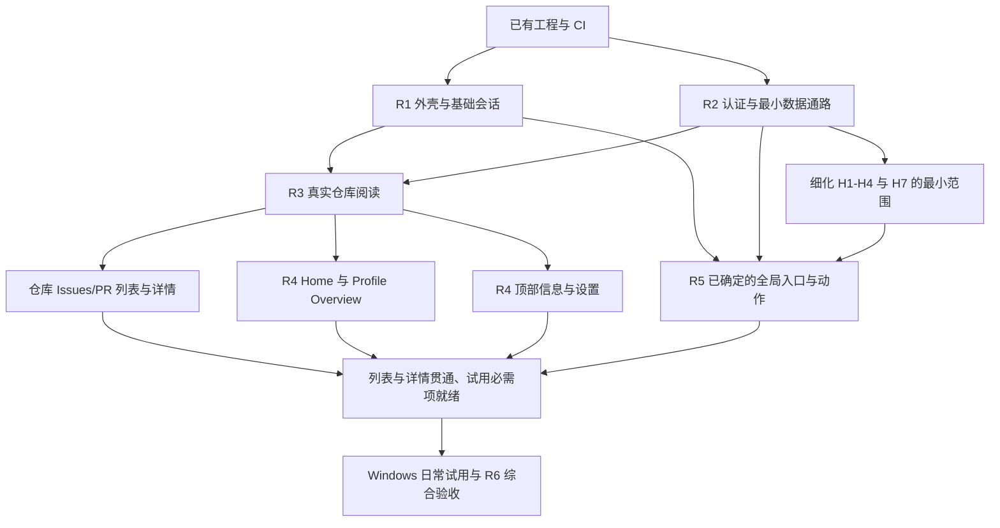

# 开发路线图

更新：2026-11-27。**Issue/PR 阅读主线已全部合入 main：仓库 Issues 列表与详情、仓库 PR 列表、PR Conversation、Files changed，以及 Home/Feed、通知和全局 Issues/PRs 到同一详情的标题接线（#105–#112）；Releases 摘要的续页读取由 #113 修复，不新增 Releases 页面。进入 Windows 日常试用前，按[试用清单](#windows-日常试用issuepr-阅读清单)做一次统一验收。** [仓库和用户主页的后续功能](#仓库与用户主页的后续功能)单独排期，列入路线图不等于已批准开工。

功能范围以 [产品约定](product.md#首版范围) 为准；状态边界、数据策略及交付规则分别见 [架构方案](architecture.md)、[缓存策略](cache-strategy.md)、[Agent 工作流](agent-workflow.md)。路线图只维护顺序、依赖和完成标准，不复制另一套产品规则。

已确认的首版功能及其直接配套工作统一归入 [First Release（milestone #1）](https://github.com/nocpiun/githux/milestone/1)，相关 PR 创建时必须关联该 milestone，操作与核验见 [首版 Milestone](agent-workflow.md#首版-milestone)。它用于进度归集，各 PR 仍独立验收与合并。

## 首版要到达的位置

做出可以实际使用的 **Windows GitHub 桌面客户端**：启动 Home，通过固定侧边栏与基础多标签访问仓库、个人主页和设置；仓库能读取真实分支、文件与 README，在紧凑摘要区展示 Releases、Contributors，并在页面底边展示 Languages；Profile Overview 包含个人 README、Pinned/Popular Repos 和贡献热力图；支持安全登录、多账户保存但单账户活动，以及已缓存内容的离线阅读。

Notifications 与全局 Issues/PRs 的现有功能保留；其余筛选、搜索、New 和新增远程写操作逐项确定最小范围。它们不是被自动排除的功能，也不能由执行者自由扩成完整 GitHub 功能集。

按既有首版边界，Packages、Environments、Profile 的 Repositories/Stars 和 Contribution Activity 延后；其中 Packages 和用户仓库列表已明确进入产品路线图，具体交付批次可单独调整。进阶标签、安装更新和 macOS/Linux 产品适配仍延后。仓库 Issues/PR 列表与详情、PR Conversation 和 Files changed 已接入；其他未设计 Tabs 维持原约定。保留既有四平台 Debug 编译与 artifact，不把编译通过称为跨平台产品支持。

## 当前证据与下一步

阅读进度以 2026-11-27 的 `main@38fb8e0` 为基线。下表区分已进入正式应用的能力、仍在开发的任务，以及需要真实账户验证的体验。

| 能力 | 已合并与源码证据 | 正式接线 / 原生验证边界 |
| --- | --- | --- |
| 正式 Rust / GPUI / Ely 外壳 | 单 Cargo package、固定依赖；[`app::run`](../src/app/mod.rs)、[`ui::Shell`](../src/ui/mod.rs) 与 workspace 标签已存在 | 窗口拖动、双击最大化、贴靠、Tall 标题栏等已有各自原生证据，见[外壳记录](devlog/2026-10-22-shell-layout.md)与 [Tall 记录](devlog/2026-10-23-tall-caption.md)。多标签完整交互、中文 IME、多 DPI/跨屏和字体回退仍待整体验收 |
| 真实账户、仓库侧栏与每账户工作区 | PR #38 已合并；[`app::accounts`](../src/app/accounts/mod.rs)、[`storage::accounts`](../src/storage/accounts.rs) 接入正式 Shell。真实 `/user/repos` 自动读取、独立账户标签、真实圆头像、空 mask 防护和头像有限总超时已实现 | Settings › Accounts 是过渡入口，不是最终 Settings 设计。真实 PAT 登录、Settings/footer 同屏交互、部分原生滚动手感与多 DPI 产品路径仍待验收，见[account-shell 记录](devlog/2026-10-28-account-shell.md) |
| Home / Feed | [`app::pages::home`](../src/app/pages/home.rs) 接入 open Issues/PRs、三类 Feed 和自动续页；[#107](https://github.com/nocpiun/githux/pull/107) 接通 Home 条目及 Feed 中有明确目标的标题和 Read more | 仓库和用户链接仍去各自页面；Events API 的覆盖范围不等于 GitHub 网页 Feed。见 [Home](home-view.md) |
| Profile Overview | [`app::pages::profile`](../src/app/pages/profile.rs) 接入目标用户、公开同名根 README、最近一年贡献、pins/gist/Popular 与内部导航 | README 按自然高度显示、缺失时省略；Pinned 描述最多三行。图片/HTML 与 Flow 已组合；全局 IME/多 DPI 验收仍独立 |
| 统一 Repository browser + overview + reader | 正式 Shell 复用 RepositoryPage 的账户 session、分支/路径/tree/reader 状态与紧凑摘要；底边 language bar、列 header、滚动条与字体修复已整合；Star/Unstar 已接入真实写路径（[PR #63](https://github.com/nocpiun/githux/pull/63)） | Fork 仍只有禁用入口，没有写 API；各页的状态与旧响应保护见[正式页面接入](shell-page-integration.md)与[仓库 Star](repository-star.md) |
| 全局组件（Settings/Notifications/Issues-PR） | 独立组件与数据适配已合并（[PR #56](https://github.com/nocpiun/githux/pull/56)、[#55](https://github.com/nocpiun/githux/pull/55)、[#57](https://github.com/nocpiun/githux/pull/57)）；Notifications 与全局 Issues/PR 已由 [#71](https://github.com/nocpiun/githux/pull/71) 注册进正式 Shell 路由 | Settings 仍是过渡 Accounts 入口；`SettingsView` 组件已合并但未挂载，最终分类与设置项仍待独立设计 |
| Issue/PR 阅读 | 仓库 Issues 列表与详情（#108、#106）、仓库 PR 列表（#112）、PR Conversation（#109）、Files changed（#111）、全局 Issue/PR 标题接线（#106、#110）、Home/Feed（#107）与通知（#105）到同一详情的入口均已合并；Releases 摘要续页由 #113 修复 | 合成测试覆盖路由、标签复用与返回状态；真实账户窗口验收见[试用清单](#windows-日常试用issuepr-阅读清单) |
| 账户持久化与业务缓存 | PR #18/#38 的账户目录与凭据引用；[cache-core](cache-core.md) 存储/授权门槛、[账户生命周期](cache-account-lifecycle.md) 绑定、[仓库](repository-cache.md)/[页面](page-cache.md)/[头像](avatar-cache.md)/[图片](reader-images.md)适配器均已合并；#68 在正式启动打开唯一应用级 `CacheStore`，#72/#69 与仓库页面消费其快照 | 仓库/Home/Profile 已支持重启后读取已缓存内容并区分历史快照，但账户 workspace 仍是内存态、重启先回 Home。C1–C5 政策已确认，容量与验证间隔仍属工程测量起点；清缓存、授权失效与跨账户隔离的端到端原生验收仍待整体验证 |
| CI 与交付流程 | PR #1/#2 起已有检查；PR #7 起 Ubuntu code-check，四平台 Debug build 与最终 `CI` 汇总保留；PR #31 增加 PR Check 门槛 | 具体 required checks 和当前 head 结果必须到 GitHub 核验；编译通过不是 Windows 以外原生产品支持，也不是 GUI 验收 |
| Agent 协作 | 独立任务、可见执行会话、PR 与审查循环已有实际使用 | 派发 skill 和完整并行调度未产品化；并行工作不能成为 main 的实现证据 |

### 下一步依赖（当前排期，不新增产品授权）

[仓库 Issues 列表](devlog/2026-11-24-repo-issue-list.md)按仓库读取；[全局 Issues/PR 列表](global-work-items.md)按 Assigned/Created、Open/Closed/All 读取与当前用户有关的条目。两者可以共用行组件，不能共用查询语义。[Issue 详情](devlog/2026-11-20-issue-detail.md)和 [PR Conversation](pr-conversation.md) 已有正式页面。

以下是这条阅读路径的交付进度和整体验收条件。单个 PR 合并不等于真实账户试用已经通过。

| 路径 | 用户目标 | 交付进度与验收条件 |
| --- | --- | --- |
| 1 · 仓库 Issues → 单条 Issue | 找到问题，阅读正文和讨论，再回到列表原位置 | 已合入 [#108](https://github.com/nocpiun/githux/pull/108)（仓库列表、筛选及续页）和 [#106](https://github.com/nocpiun/githux/pull/106)（详情、正文与普通评论）。整体验收应覆盖同号不同仓库、列表不混入 PR，以及返回后的筛选和滚动位置。 |
| 2 · 仓库 PRs → 单条 PR | 了解改动目的、目标分支、合并状态和文件差异 | [#109](https://github.com/nocpiun/githux/pull/109) 交付 Conversation、[#112](https://github.com/nocpiun/githux/pull/112) 交付仓库 PR 列表（筛选/续页/返回保持）、[#111](https://github.com/nocpiun/githux/pull/111) 交付 Files changed。文件清单区分可读文本 diff、二进制及截断或不可用的 patch；Commits、Checks 与行内评审线程另定。 |
| 3 · 跨入口打开与刷新 | 同账户从不同入口打开同一条 Issue/PR，复用同一份详情 | Home/Feed（#107）、可识别目标的通知（[#105](https://github.com/nocpiun/githux/pull/105)）、全局 Issue 标题（#106）与全局 PR 标题（[#110](https://github.com/nocpiun/githux/pull/110)）均已合入。统一验收缓存首屏、刷新不闪白、失败重试、切账户后不接收旧响应；通知 thread ID 不能当作资源编号。 |
| 4 · 定下试用要做的其他事 | 不仅能读，还能明确哪些日常工作要在客户端完成 | 分别定稿全局/仓库 Settings 的首批项目、命令面板搜索范围、收件箱剩余交互以及 New/H7。建议优先讨论发普通评论和创建 Issue，再决定是否需要状态修改、评审提交或合并 PR。每项写明“试用前必需 / 后续 / 不做”；只实现选定项，注明失败反馈及数据更新方式。 |

**本批阅读路径已全部合入 main，剩余的是整套试用验收。** 新入口沿用既有资源标识（账户上下文、仓库、类型、编号）和[缓存约定](cache-strategy.md)。Settings 和搜索范围仍可同时讨论；第 4 步的范围决定与发布评论、提交评审、合并等写操作仍未批准。

**何时开始 Windows 日常试用：** 阅读主线已在 main 可用，先按[试用清单](#windows-日常试用issuepr-阅读清单)做一次 Issue/PR 阅读验收，再继续第 4 步的范围决定与 R6 综合验收。第 4 步选为试用必需的项目仍需可用后才能整套日常试用；最终 R6 另验真实 PAT、断网/重连与缓存清理、中文 IME、键盘、长列表、多 DPI 和跨屏。

已有 CI 的分支规则是否启用，以仓库实际设置为准。路线图不替负责人修改规则。负责人已于 2026-10-22 解除首次试跑的单实现者限制，并明确按依赖、文件冲突、编译资源与审查积压安排并行；这不改变同一任务同一时刻只有一个有效写入者的要求。

## Windows 日常试用：Issue/PR 阅读清单

负责人只需最新 main，不用切任务分支或建预览 worktree。一次登录后按下面顺序走一遍；无法取得的真实数据单独标为“未覆盖”，不要用合成数据冒充。

### 准备（干净最新 main）

1. 取最新 main 并确认无未提交改动：`git switch main && git pull --ff-only && git status --short`。
2. 用 [README](../README.md#windows-安装与运行) 的正常启动命令 `cargo run --locked` 启动正式应用；首次构建等待编译完成即可，不需要 `cargo build`、测试或预览 example。
3. 在 Settings › Accounts（过渡入口）添加一个真实 Classic PAT 并登录，确认侧栏出现真实仓库列表。

### 1 · 仓库 Issues 列表 → 单条 Issue

1. 侧栏点开一个确有多条 Issue 的仓库，切到页内 **Issues** Tab。
2. 核对列表只含该仓库的 Issue（不混入 PR），Open/Closed 筛选切换，滚动到底出现 **Load more** 并能续页。
3. 点一条标题 → 打开新标签，看到 Issue 正文（Markdown）与普通评论，空正文显示 “No description provided.”，评论可 **Load more comments**。
4. 关掉详情标签，回到仓库页：筛选与滚动位置保持，不重读列表。

### 2 · 仓库 PRs 列表 → Conversation → Files changed

1. 同一仓库切到 **Pull requests** Tab，Open/Closed 筛选，**Load more** 续页，Draft/Open/Merged/Closed 状态可见。
2. 点一条标题 → PR Conversation：摘要（作者、base/head 分支、合并状态）、正文与普通评论；切到 **Files changed** Tab。
3. Files changed 首次点击才读取；文本 diff 有增删与行号，重命名显示原路径，无 patch 显示不可用；**Previous/Next** 分页，空 PR 显示 “No changed files.”。
4. 关掉详情回到仓库页：筛选与分页位置保持。

### 3 · 全局列表与跨入口同一目标

1. 侧栏底部 **Issues** / **PRs** 入口分别打开全局个人列表；核对 Assigned/Created × Open/Closed/All 筛选与 **Load more**。
2. Issue 标题 → Issue 详情，PR 标题 → PR Conversation；同行仓库名链接仍去仓库页，不与标题共用目标。
3. 从 Home 左栏条目标题（或图标、`#number`）打开同一 Issue/PR；Feed 的合并 PR 图标、含 `#number` 的标题与 **Read more** 打开同一 PR。
4. 同账户同一目标从不同入口打开时复用同一标签，不重复建标签；同号不同仓库、同库 Issue/PR 不串。

### 4 · 通知（需真实可识别目标，无则跳过并标注）

1. 账号行右侧铃铛打开 Notifications；只点击 Issue/PR 主题可打开对应详情，其余类型保持纯文本、不猜测跳转。
2. **回退**：若该账户没有相关通知，从全局列表或仓库列表打开同一 Issue/PR 完成跨入口验收，并把“通知直达”标为未覆盖，不要伪造通知。

### 5 · 导航状态与刷新

1. 详情打开后按标签条右侧 Refresh：保留可见内容重读，失败显示 Retry 而不抹掉正文/评论；未登录或授权失效时禁用。
2. 切账户后再打开同一仓库：旧账户标签不复活，旧响应不进入新账户页面。

### 哪些步骤需要真实 Windows / 真实账户数据

- 全部点击、滚动、筛选与视觉观感都需要真实 Windows 窗口与真实 PAT（本清单全部如此）。
- 合成/本地已验证的只是：路由与标签复用、列表筛选/续页/返回保持、Issue/PR 正文与评论渲染、Files changed 懒加载与分页、跨入口目标解析，证据在 `src/app/pages/tests.rs`、`home/shell_nav_tests.rs` 与 `pr_files_integration_tests.rs`；它们不能替代本清单的真实窗口验收。
- 需要真实数据的步骤：登录、通知收件箱（第 4 步）、Feed 关注动态、私有仓库可见性、限流/断网/授权失效提示。若账户没有相关通知或 Feed 事件，按回退执行并标注，不能把“无数据”当作验收通过。

## 仓库与用户主页的后续功能

看完代码、Issue 或 PR 后，用户往往要找“哪个版本包含它”“哪里能拿到发布物”“作者还有哪些仓库”。这三条路径单独排期。下表是建议顺序；之前首版只确认 Releases 摘要、延后 Packages 和 Profile 其他 Tabs 的约定并未因本次规划自动改变。

| 工作项 | 当前基础与建议依赖 | 第一段可验收的体验 |
| --- | --- | --- |
| Releases：版本列表与详情 | [仓库摘要](repository-overview.md)已有 latest/计数；仓库 Releases Tab 仍为空。先复用[发布元数据读取](repository-extras-service.md)，不依赖 Issue/PR 详情。建议在核心阅读主线旁优先推进。 | 从摘要打开对应版本，从 Releases Tab 分页浏览历史；能看 tag、发布日期、Markdown 发布说明和附件名称/大小。能区分最新正式版、预发布与当前账户可见的草稿；只有预发布时仍能浏览。确认无版本时隐藏摘要；请求失败不显示“0 个版本”。附件先提供用户主动打开下载的入口，发布、上传、删除不在这一步。 |
| Profile → Repositories：按用户找仓库 | [Profile Overview](profile-view.md) 只有 Pinned/Popular 摘要；侧栏的仓库范围是登录账户可访问的集合。独立于 Releases，可复用仓库卡片及应用内仓库导航。 | 从本人或他人主页进入 Repositories，分页浏览该用户拥有且当前身份可见的仓库，按名称查找并打开仓库，回来仍在原位置。对他人先保证公开仓库；本人可见的私有仓库须按授权读取。协作仓库不误算成该用户拥有，局部名称筛选不冒充搜完所有分页。 |
| Packages：仓库关联的包与版本 | 当前没有产品页面。先验证包归属、仓库关联与读取权限，再选一种有样例的包类型打通（建议优先容器镜像）；后续再扩展包类型。此项无需等 Releases 做完。 | 从一个有关联包的仓库进入，看到包名、类型和版本；选中版本能查看标识，并复制已核实的安装或拉取命令。用同一 owner 下两个不同仓库验证不串包；查不到关联不能把 owner 的全部包挂到仓库。已确认无包则隐藏摘要，权限不足或数据不全单独处理。不发布、删除或自动执行安装命令。 |

接口核验入口：[GitHub Releases](https://docs.github.com/en/rest/releases/releases)、[用户与仓库列表](https://docs.github.com/en/rest/repos/repos)、[GitHub Packages](https://docs.github.com/en/rest/packages/packages)。开工时用目标账户和代表性样例分别核对，不把产品草案当作 API 能力证明。

除这三项外，后续按使用路径维护候选清单。以下不是已批准的首版菜单：

| 路径 | 可独立交付的一步 | 与已有功能的边界 |
| --- | --- | --- |
| 从代码追历史 | 分支与 Tags 列表 → 提交历史 → 单次提交的文件差异 | 先保留所选 ref 与路径，不把现有分支切换器当历史页；与 PR 的 Files changed 可复用差异展示。 |
| 从仓库找到维护者，再发现项目 | Contributors 完整列表 → Profile；后续是 Stars、Followers/Following | 先贯通已有贡献者摘要、用户主页和仓库入口；个人收藏、关注关系、贡献时间线分别排期。 |
| 从变更看交付结果 | Actions 运行列表与只读结果；Environments / Deployments 的环境和部署记录 | PR Checks、工作流运行、部署记录分别呈现；无权限不报作“没有运行”。重跑、审批与部署另议。 |
| 从提醒找到下一项工作 | 通知直达可识别资源、跨仓库搜索、Settings 和 New 的最小操作 | 复用上方已规划的详情路由。搜索类别和写操作逐项定稿，不引入网页全部菜单。 |

**排期建议：** 先收齐上述三项阅读工作并统一验收。Releases 与用户仓库列表可独立细化，Packages 先验证仓库关联与读取权限。进入 Windows 日常试用前，再据实际使用任务选定是否必须包含这些扩展。

## 工作区导航：右侧栏与标签树

**已列入规划；本轮交付设计，实施批次待定。** 多个标签横向滚出视野时，可以从右栏按两层树切换：第一层为完整 `owner/repo` 或独立页面，第二层为仓库已打开的资源；没有所有者层或文件夹层。顶部标签与树共享同一工作区；右栏完全收起时把宽度还给正文。参见[展开 / 收起对照和交互说明](right-sidebar.md)。这条外壳工作可先用当前已有路由设计与验证，不改变仓库 Issue/PR 阅读的近期优先级。

1. 先验收右栏在 Home/Feed 与窄窗口中的位置和宽度：展开/收起、圆头 resize sash、活动行背景动效复用左栏；开关留在面板外，收起后没有图标列。
2. 用已有标签接通双向选择、关闭、排序与账户隔离。后续 Issue 或文件有独立标签身份时再纳入相应子节点；不将仓库文件树复制进标签树。
3. 右栏顶部保留仅图标的视图切换栏，首项为标签树。其他视图有真实用途再立项；本轮不添加占位入口。

## 推进方式

建议先打通一条真实仓库阅读链路，再扩展页面。外壳验证与 API/认证核验可以按依赖分别推进；数据模型从第一次请求就携带账户和资源版本，不留到所有页面完成后返工。

下面的 R1–R6 表示能力顺序，不是必须整批完成才能合并的里程碑。每项可拆成多个小 PR，完成验收后直接合入 main；没有依赖的任务无需等待同一行其他工作。负责人已解除首次试跑的单实现者限制，当前按依赖、文件冲突、编译资源与审查积压安排并行，不固定 Agent 总数。

R4 各页面可以独立交付；R5 不依赖所有 R4 页面完成。若具体动作涉及某页面或数据类型，只增加那一项依赖。缓存、输入、性能和诊断随各条链路交付，R6 是整体验证，不是第一次处理这些问题。

## R1：外壳与基础会话

**目标：** 用确定性假数据验证真正的桌面交互，而不先铺满所有业务页面。

- 实现 Windows 自定义标题栏、island、固定导航和仓库 group 的有界独立滚动；复用 Ely 主题与组件组合。**已交付**：见[外壳布局开发日志](devlog/2026-10-22-shell-layout.md)。侧栏受限 resize、收起图标栏/底部菜单、行外活动线与间距调整已合并；当时的审查/验收记录见[侧栏开发日志](devlog/2026-10-25-sidebar-layout.md)，剩余原生交互统一列入 R6，不把历史 PR 的“禁止自动合并”当作当前状态。
- 建立路由、`TabId` 与页面局部状态。先支持打开、切换和关闭；仓库分支/文件、Profile 页面和各自滚动与焦点互不串用。应用会话标签与页内内容 Tabs 分离。**已实现**：`workspace::Workspace` 持有有序会话集合、活动标签与每标签的滚动/焦点/仓库会话状态，打开/复用/切换/关闭、标签条水平滚动与中键关闭见 [基础标签规则](product.md#外壳与导航) 和 [开发日志](devlog/2026-10-23-workspace-tabs.md)；**真实窗口人工验收待完成**。拖拽排序、hover 显示关闭按钮与右侧固定工具栏已按 2026-10-25 反馈实现，同样待人工验收。

- 放置右上角 command palette 入口和底部四入口，先完成焦点、弹出/关闭和路由约定。具体搜索结果由后续选定范围接入。**入口、本地导航结果、焦点返回已交付**；真实搜索范围未接入。
- 首次接入文本输入与阅读控件时验证中文 IME、选择复制、字形回退和 DPI。原型补丁先重现再决定是否采用，不默认整体搬入正式工程。**首次文本输入已出现**；组合态逻辑有测试平台用例，真实 IME 与多 DPI 仍待人工验收。
- 形成最小共享组合：仓库行、元信息、设置行与页面状态显示。由实际复用产生组件，不预建庞大通用 UI 框架。**仓库行、页面外壳与过渡 Accounts 设置行已产生**；更多正式页面状态随 shell-pages 接线，最终设置分类仍待设计。

**验收：** 启动 Home；侧边栏只有仓库区域滚动；能同时打开仓库 A/B 与 Profile 并保持各自状态；窗口拖动、最大化、贴靠、键盘焦点与中文候选确认正常；未设计的详情内容仍留空。

**当前状态：** 启动 Home、只有仓库区域滚动、窗口拖动/最大化/贴靠、键盘焦点与留空页面已在本机真实窗口核验；同时打开仓库 A/B 与 Profile 并保持各自滚动/焦点/仓库会话状态已由 GPUI 测试平台覆盖，但**真实窗口多标签交互与中文候选确认仍待负责人验收**，因此 R1 不能标记完成。

**已确认（负责人 2026-10-23，2026-10-25 修订）：** 基础标签的打开/复用与关闭规则、Home/Settings/全局占位页按路由单例、关闭最后标签回到 Home、最小窗口 880×560 见 [基础标签规则](product.md#外壳与导航)。标签数量不设上限，溢出改用标签条水平滚动（含细的半透明可拖动滚动条、Shift+滚轮与原生水平滚动），取代此前 8 标签预览上限与该条 H6 排除；2026-10-25 又确认了标签拖拽排序、hover/active 才显示关闭按钮与最右侧固定工具栏（先只放禁用的刷新入口），这些也从 H6 排除中移出。H6 其余项（专门溢出菜单、固定标签、拖出新窗口、导航历史、重启恢复）仍排除。账户切换时标签如何处理已于 2026-10-28 确认：每个账户拥有独立标签集合，切回恢复该账户标签；这是进程内内存状态，重启仍从 Home 开始（见 [产品约定](product.md#外壳与导航)）。

## R2：认证与最小数据通路

**目标：** 确认真实数据能按约定安全、可取消地进入 GPUI，建立 R3 必需的最小服务。

- [API 能力表](github-api-capabilities.md) 已由 PR #6 交付，作为接口/权限/分页/缺失情形和刷新限制的输入；研究结果不等于真实集成验证。无法覆盖的需求交回讨论，不悄悄改用网页 Cookie 或内部端点。
- 按已确认的 [PAT 产品登录方案](product.md#登录与未来写能力) 接入 Classic PAT，引导创建、验证身份与权限、系统凭据保存和替换；不建设认证后端。当前先读取，服务边界保留未来写操作的权限判断和写后缓存失效，具体动作另行细化。
- 实现账户元数据、平台凭据引用、活动账户上下文和切换失效机制。多账户保存、单账户活动是基线；不在 UI 或普通数据库保存 token。
- 验证后台执行与 GPUI 的桥接、取消、应用关闭、超时、重试及限流反馈。实际已选 reqwest + Tokio 与 rusqlite 账户目录；具体缓存实现和参数不因这些选型自动确定。
- 建立最小存储版本、可清缓存与用户数据分区、脱敏日志和错误分类。首先只落地仓库链路需要的数据，不一次实现缓存表中所有资源。

**验收：** 应用可识别授权账户并读取最小仓库数据；令牌失效、权限不足、断网和限流不会被显示成有效空列表；切换账户后旧响应不写入新账户的缓存或页面；关闭应用不遗留无归属工作，日志不含凭据。

**当前状态：** 账户目录、系统凭据、真实账户/仓库读取、自动加载和正式 Shell 控制器已由 PR #18/#28/#38 合并；不再描述为“UI 未接入”或“账户元数据未落盘”。每账户 workspace 也已接入。业务内容缓存仍不在这些交付内，真实 PAT 与部分原生交互验收边界见[当前证据表](#当前证据与下一步)。

**已确认：** PAT 为产品登录方式，仓库范围为当前授权下 `/user/repos` 的完整分页可见集合。

**已决定：** 账户切换时的标签处理（每账户独立标签，2026-10-28）。**进入相关实现前仍需决定：** PAT 引导的最小权限清单、授权失效和移除账户后的私有内容策略。特别是私有内容落盘前，必须明确其保留规则。

## R3：完整的真实仓库阅读链路

**目标：** 登录后能从仓库列表进入仓库，选择分支和文件并阅读内容；中间交付也保持启动 Home 的约定。

- 接入完整可分页的仓库列表、namespace 头像、仓库资料和统计；明确已加载页与完整集合的区别。
- 从分支解析本次浏览的提交版本，使提交说明、文件树和正文对应同一快照；不同标签的浏览选择独立，共享可复用数据。
- 实现 README 默认发现、Markdown 阅读、只读源码查看、选择复制及相对资源解析；验证图片和长内容，不从简单样例推断完整 Markdown 覆盖。
- 覆盖空仓库、没有 README、缺失/不可见文件、非文本或过大内容的边界。具体呈现与读取上限在任务规格中选定。
- 按 [缓存策略](cache-strategy.md) 实现这条链路的结构化快照、固定版本内容和头像磁盘缓存；latest 在确认前不冒充当前最新值。

**验收：** 两个仓库标签可以独立切换分支和文件；快速切换时旧响应不覆盖新页面；关闭一个标签不误取消其他标签共享的读取；重新启动后离线可读之前缓存的仓库内容，但不恢复旧标签集合，仍先进入 Home；无缓存、旧版本与真实空数据可区分。

**当前状态：** 固定快照读取、账户作用域 session、reader 和统一 RepositoryPage 已接入正式 Shell，并由本批 `repository-offline` 接入持久缓存：重启后可按最后已知授权读取已缓存摘要、分支、目录、README、正文与图片，历史快照与当前值分开展示。授权撤权在当前 drain 内清空页面（不依赖定时探测），图片按固定 commit 复用。完整验证边界见[正式页面接入](shell-page-integration.md)与[仓库缓存](repository-cache.md)。

**首个内部自用检查点：** 此链路通过后即可试用仓库阅读，收集真实数据、输入与性能问题；它不代表已完成包含 Home、Profile 等内容的整个首版，也不自动缩减其他保留功能。

## R4：扩展保留的页面和仓库信息

基础账户、查询模型和阅读器可用后，下列任务按接口依赖独立推进。

| 任务 | 范围 | 主要验收 |
| --- | --- | --- |
| Home | 左栏标题 Home：最近参与且有更新的 Issues/PRs；右栏标题 Feed：关注动态 | 依据 [数据范围](product.md#home-与-feed-的数据范围) 明确参与查询；接受 Events 延迟；分页、无活动、刷新和离线旧列表有对应状态 |
| Profile Overview | 资料、个人 README、Pinned/Popular、贡献热力图 | 本人/他人资料、无 README、无 Pinned、长内容均可读；不接入 D5 或 H5 |
| 仓库摘要与 Languages | Releases、Contributors、Languages | Releases/Contributors 在资料后的紧凑摘要区，Languages 在页面底边；窄窗口、内容为空或单项请求失败时仍能阅读文件；不请求或展示 Packages/Environments，不扩张为管理控制台 |
| 全局与仓库 Settings | 经确认的最小设置项目、统一行式风格 | 本地设置重启仍保留；区分本应用偏好与 GitHub 远端设置，不能把本地保存显示成远端成功 |
| Command palette 数据 | 经确认的搜索类别和结果路由 | 查询变化取消/淘汰旧结果；结果打开正确会话；离线不冒充已完成实时搜索 |

Feed 已选择 Events API，负责人接受其延迟；负责人 2026-10-30 确认只保留合并 PR、星标仓库、创建仓库三类活动、保持服务顺序，且每条卡片主语必须是当前账户关注的人（合并贡献取 PR 作者，需读 PR 详情确认），初始手动刷新，不自动轮询，也不承诺复刻网站全部 Feed；Follow 两类事件卡片暂缓。Home 查询为 `involves:` + `is:open`、无时间窗口、按 updated 降序；Profile 的公开同名根 README、pins/gist 提示、仅无 pin 才 Popular 与最近一年范围已确认。具体边界统一见[产品约定](product.md#home-与-feed-的数据范围)。

**当前状态：** Home/Profile/Repository 三个产品路由已统一接入真实数据入口，Notifications 与全局 Issues/PR 也已注册进正式路由；Settings 仍是过渡 Accounts 页面。远程搜索、最终 Settings 与整体原生验收尚未完成。

**验收：** 保留页面全部使用真实数据入口，不保留假数据冒充已接入；加载、部分失败、权限不足、旧值与离线行为遵循统一约定。远端设置若包含写入，依赖 R5 选定的写操作契约，不绕开权限与失败处理。

## R5：补齐全局入口与选定动作

**已有列表与动作继续使用。** 下表只安排剩余范围；新增入口与动作先确定最小目标，再按依赖交付，不必等待所有 R4 页面。

| 项目 | 需要决定的最小范围 |
| --- | --- |
| H1 Notifications | 已接入收件箱、已确认的通知操作及可可靠识别的 Issue/PR 详情跳转（#105）。其他类型保留原行为，不猜测跳转目标。 |
| H2/H3 全局 Issues/PRs | 已有个人列表、筛选与分页；全局 Issue 与 PR 标题均已可打开对应详情（#106、#110）。仓库列表独立查询；新增筛选按使用场景决定。 |
| H4 New | 实际可创建的资源清单、所需输入、权限与提交结果；入口存在不代表已承诺创建组织等所有动作 |
| H7 远程写操作 | 明确选哪些动作、影响哪些页面、权限与确认/失败反馈；仓库 Star/Unstar 已作为首个动作实现，标记已读等仍是候选，不是已批准清单 |

Issue/PR 阅读按上方新顺序规划。阅读已有评论与发布评论是两个交付；有详情入口不代表已批准编辑器、审批或合并操作。

**写操作共同验收：** 仅按确认范围在线执行；服务端结果驱动页面和缓存更新；较旧读取不能盖掉成功写入后的状态；超时后核对是否已生效，不无条件重发。离线草稿和自动重放队列未被纳入本轮。

若这些项目未明确范围，应报告“首版范围仍待决定”，不能把整项视为已完成或暗中排除后宣布首版交付。

## R6：Windows 首版综合验收

在上述列表、详情与试用必需项就绪后，验证完整用户路径和长期使用质量。无需等待安装包或自动更新系统；通过当前构建和可执行文件验收。

- 从启动 Home、登录/切账户到仓库与全局列表、Issue/PR 详情、多标签阅读、搜索、Settings 及已选定的操作，完整走通。
- 各保留数据类型验证离线/重连、权限变化、分页、刷新与缓存清理；清缓存不得删除设置或账户引用。重启可用的内容缓存与 H6 的会话恢复分开验证。
- 在真实 Windows 窗口验证多 DPI、跨屏、中文 IME、文本选择、焦点恢复、长列表、长 README、频繁切换及标签关闭后的资源释放。
- 记录启动、交互延迟、滚动、内存、图片资源、网络次数和磁盘占用的可复现条件。性能基线从 R1/R3 开始采集，再确定预算；不凭截图宣布“丝滑”，也不把 Debug 与未来其他构建模式的结果混比。
- 检查依赖/字体许可证、脱敏诊断、存储版本升级和错误后的可恢复性。H8 延后不等于可以损坏持久数据。
- 当最新提交的 CI、代码审查和相关真实交互验收均通过，并且保留项没有未决范围时，记录首版交付证据。现有合并规则按每个 PR 执行，不等到此处才开始审查。

## 任务边界与可并行部分

| 工作线 | 可以独立推进的内容 | 需要协调的交点 |
| --- | --- | --- |
| 外壳与体验 | Windows 窗口、island、基础会话、字体/IME 实验 | 路由、`TabId`、应用入口、统一主题 |
| 认证与数据 | API 能力核验、凭据、请求执行与取消、存储实验 | 账户上下文、业务模型、缓存键和错误模型 |
| 内容阅读 | Markdown/源码控件、图片与大内容边界，可先用 fixture | 固定版本资源标识、共享内容服务 |
| 页面 | Home、Profile、仓库摘要、Settings，接口稳定后分别接入 | 共享组件和领域类型，避免各页面自建网络/SQL 路径 |
| 工程支持 | 派发上下文、审查信号核验、CI 与诊断改进 | 只解决实际交付阻力，不先建设常驻调度平台 |

每个任务一个有效写入者、独立 worktree/PR。共享接口先明确最小数据与错误契约；依赖任务可以先基于 fixture 开发视图，但完成状态必须注明真实数据是否已经接入。不按阶段建立长期集成分支，不为并行而同时修改相同入口。

## 后续任务的进入条件

具体当前优先级与依赖见[下一步依赖](#下一步依赖当前排期不新增产品授权)，这里只保留进入条件，避免旧建议覆盖已交付事实：

- shell-pages 以本基线已合并组件和账户接口为输入，正式路由验证后才标记接通。
- Settings 最终设计与持久缓存应用接线分别需要自己的明确规格；README 图片与各类缓存适配器已合并，未批准的 local-only 方案不自动成为依赖。
- H1–H4/H7、搜索范围和设置首批项目在相关实现前消除范围歧义；基础标签、账户切换恢复、Home/Feed/Profile 默认规则及仓库摘要位置已经确定，不重复裁决。
- 输入/DPI 与综合验收随正式链路推进，不把组件预览或 CI 当最终证据。

近期还需决定是否在试用前读取行内评审线程，以及哪些写操作、搜索与设置项是试用必需的。PAT 权限引导和缓存参数结合所选能力细化；私有内容撤权/移除遵循现有 C1–C5，仍需端到端验证。

## 维护方式

范围变化先更新 [产品约定](product.md)，再调整本路线图的依赖与验收。实现结论更新对应主题及任务开发日志，引用实际 PR/源码；只有验收证据充分时才把任务标为完成。CI 构建成功、页面截图、模拟数据通过和真实产品可用分别记录。

后续候选见[仓库与用户主页的后续功能](#仓库与用户主页的后续功能)：先记录用户路径与依赖，再结合使用反馈确定批次。开发路线图不能替代任务授权，也不能恢复已排除的功能。
