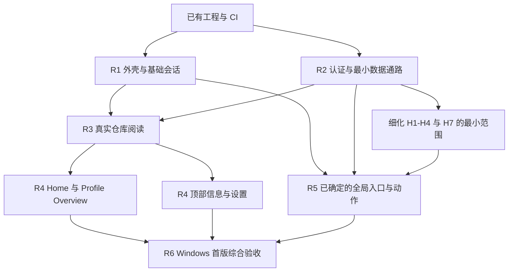

# 开发路线图

更新：2026-10-22。**首版功能取舍已确认；本文的开发顺序和任务拆分为讨论稿。** 外壳布局已作为 R1 的第一份交付实现，PAT 登录方向已确认，其余业务链路尚未开始。本文不承诺日期，也不把路线图中的建议变成已批准的产品细节。

功能范围以 [产品约定](product.md#首版范围) 为准；状态边界、数据策略及交付规则分别见 [架构方案](architecture.md)、[缓存策略](cache-strategy.md)、[Agent 工作流](agent-workflow.md)。路线图只维护顺序、依赖和完成标准，不复制另一套产品规则。

已确认的首版功能及其直接配套工作统一归入 [First Release（milestone #1）](https://github.com/nocpiun/githux/milestone/1)，相关 PR 创建时必须关联该 milestone，操作与核验见 [首版 Milestone](agent-workflow.md#首版-milestone)。它用于进度归集，各 PR 仍独立验收与合并。

## 首版要到达的位置

做出可以实际使用的 **Windows GitHub 桌面客户端**：启动 Home，通过固定侧边栏与基础多标签访问仓库、个人主页和设置；仓库能读取真实分支、文件与 README，顶部展示 Releases、Contributors、Languages；Profile Overview 包含个人 README、Pinned/Popular Repos 和贡献热力图；支持安全登录、多账户保存但单账户活动，以及已缓存内容的离线阅读。

Notifications、全局 Issues/PRs、New 和远程写操作保留为待细化范围，须逐项确定最小功能。它们不是被自动排除的功能，也不能由执行者自由扩成完整 GitHub 功能集。

本轮不建设 Packages、Environments、Contribution Activity、Profile 其他 Tabs、标签进阶操作、安装更新系统或 macOS/Linux 产品适配。Issue/PR 详情和仓库其他未设计 Tabs 继续按产品约定留空。保留既有四平台 Debug 编译与 artifact，不把编译通过称为跨平台产品支持。

## 已有基础

| 能力 | 当前证据与边界 |
| --- | --- |
| 正式 Rust / GPUI / Ely 工程 | 单 Cargo package、固定依赖；[启动入口](../src/app/mod.rs) 与 [外壳视图](../src/ui/mod.rs) 已实现 |
| Windows 外壳与基础交互 | 自定义标题栏、island、固定侧边栏与有界仓库组、本地导航搜索浮层、应用级基础标签已实现；拖动、双击最大化、贴靠与窗口按钮在本机真实窗口核验，见 [开发日志](devlog/2026-10-22-shell-layout.md)；Windows 原生 Tall 标题栏（系统绘制按钮、48px 顶栏）已由 PR #13 验收合并，见 [Tall 标题栏记录](devlog/2026-10-23-tall-caption.md)。中文 IME、多 DPI 跨屏与逐个窗口按钮验收仍待完成 |
| Windows 字体 | 字体随 binary 注册、启动不再分配控制台；中文回退与 IME 尚未验收 |
| CI 与交付流程 | [PR #1](https://github.com/nocpiun/githux/pull/1)、[PR #2](https://github.com/nocpiun/githux/pull/2) 已交付；PR #7 起代码检查在 Ubuntu 24.04 运行（fmt/check/clippy/test），四平台 Debug Build 与最终 `CI` 汇总 job 不变 |
| 业务架构 | `workspace/auth/data/github/network/storage/content` 等仅预留职责，不能算已有账户、API、缓存或阅读器实现 |
| Agent 协作 | 独立任务、可见执行会话、PR 与审查循环已有实际使用；派发 skill 和完整并行调度尚未产品化 |

已有 CI 的分支规则是否启用，以仓库实际设置为准。路线图不替负责人修改规则。负责人已于 2026-10-22 解除首次试跑的单实现者限制，并明确按依赖、文件冲突、编译资源与审查积压安排并行；这不改变同一任务同一时刻只有一个有效写入者的要求。

## 推进方式

建议先打通一条真实仓库阅读链路，再扩展页面。外壳验证与 API/认证核验可以按依赖分别推进；数据模型从第一次请求就携带账户和资源版本，不留到所有页面完成后返工。

下面的 R1–R6 表示能力顺序，不是必须整批完成才能合并的里程碑。每项可拆成多个小 PR，完成验收后直接合入 main；没有依赖的任务无需等待同一行其他工作。负责人已解除首次试跑的单实现者限制，当前按依赖、文件冲突、编译资源与审查积压安排并行，不固定 Agent 总数。

R4 各页面可以独立交付；R5 不依赖所有 R4 页面完成。若具体动作涉及某页面或数据类型，只增加那一项依赖。缓存、输入、性能和诊断随各条链路交付，R6 是整体验证，不是第一次处理这些问题。

## R1：外壳与基础会话

**目标：** 用确定性假数据验证真正的桌面交互，而不先铺满所有业务页面。

- 实现 Windows 自定义标题栏、island、固定导航和仓库 group 的有界独立滚动；复用 Ely 主题与组件组合。**已交付**：见 [外壳布局开发日志](devlog/2026-10-22-shell-layout.md)。
- 建立路由、`TabId` 与页面局部状态。先支持打开、切换和关闭；仓库分支/文件、Profile 页面和各自滚动与焦点互不串用。应用会话标签与页内内容 Tabs 分离。**已实现**：`workspace::Workspace` 持有有序会话集合、活动标签与每标签的滚动/焦点/仓库会话状态，打开/复用/切换/关闭与 `MAX_OPEN_TABS = 8` 预览上限见 [基础标签规则](product.md#外壳与导航) 和 [开发日志](devlog/2026-10-23-workspace-tabs.md)；**真实窗口人工验收待完成**。
- 放置右上角 command palette 入口和底部四入口，先完成焦点、弹出/关闭和路由约定。具体搜索结果由后续选定范围接入。**入口、本地导航结果、焦点返回已交付**；真实搜索范围未接入。
- 首次接入文本输入与阅读控件时验证中文 IME、选择复制、字形回退和 DPI。原型补丁先重现再决定是否采用，不默认整体搬入正式工程。**首次文本输入已出现**；组合态逻辑有测试平台用例，真实 IME 与多 DPI 仍待人工验收。
- 形成最小共享组合：仓库行、元信息、设置行与页面状态显示。由实际复用产生组件，不预建庞大通用 UI 框架。**仓库行与页面外壳已抽出**；设置行与更多页面状态尚未产生。

**验收：** 启动 Home；侧边栏只有仓库区域滚动；能同时打开仓库 A/B 与 Profile 并保持各自状态；窗口拖动、最大化、贴靠、键盘焦点与中文候选确认正常；未设计的详情内容仍留空。

**当前状态：** 启动 Home、只有仓库区域滚动、窗口拖动/最大化/贴靠、键盘焦点与留空页面已在本机真实窗口核验；同时打开仓库 A/B 与 Profile 并保持各自滚动/焦点/仓库会话状态已由 GPUI 测试平台覆盖，但**真实窗口多标签交互与中文候选确认仍待负责人验收**，因此 R1 不能标记完成。

**已确认（负责人 2026-10-23）：** 基础标签的打开/复用与关闭规则、Home/Settings/全局占位页按路由单例、关闭最后标签回到 Home、`MAX_OPEN_TABS = 8` 预览上限与最小窗口 880×560 见 [基础标签规则](product.md#外壳与导航)。H6 已排除，不建设拖拽重排、专门溢出交互、导航历史或重启恢复。账户切换时标签如何处理仍未决定。

## R2：认证与最小数据通路

**目标：** 确认真实数据能按约定安全、可取消地进入 GPUI，建立 R3 必需的最小服务。

- [API 能力表](github-api-capabilities.md) 已由 PR #6 交付，作为接口/权限/分页/缺失情形和刷新限制的输入；研究结果不等于真实集成验证。无法覆盖的需求交回讨论，不悄悄改用网页 Cookie 或内部端点。
- 按已确认的 [PAT 产品登录方案](product.md#登录与未来写能力) 接入 Classic PAT，引导创建、验证身份与权限、系统凭据保存和替换；不建设认证后端。当前先读取，服务边界保留未来写操作的权限判断和写后缓存失效，具体动作另行细化。
- 实现账户元数据、平台凭据引用、活动账户上下文和切换失效机制。多账户保存、单账户活动是基线；不在 UI 或普通数据库保存 token。
- 验证后台执行与 GPUI 的桥接、取消、应用关闭、超时、重试及限流反馈。HTTP/运行时/数据库库选型仍需依据实验确定，不因已有传递依赖而默认采用。
- 建立最小存储版本、可清缓存与用户数据分区、脱敏日志和错误分类。首先只落地仓库链路需要的数据，不一次实现缓存表中所有资源。

**验收：** 应用可识别授权账户并读取最小仓库数据；令牌失效、权限不足、断网和限流不会被显示成有效空列表；切换账户后旧响应不写入新账户的缓存或页面；关闭应用不遗留无归属工作，日志不含凭据。

**已确认：** PAT 为产品登录方式，仓库范围为当前授权下 `/user/repos` 的完整分页可见集合。

**进入相关实现前需决定：** PAT 引导的最小权限清单、账户切换时的标签处理、授权失效和移除账户后的私有内容策略。特别是私有内容落盘前，必须明确其保留规则。

## R3：完整的真实仓库阅读链路

**目标：** 登录后能从仓库列表进入仓库，选择分支和文件并阅读内容；中间交付也保持启动 Home 的约定。

- 接入完整可分页的仓库列表、namespace 头像、仓库资料和统计；明确已加载页与完整集合的区别。
- 从分支解析本次浏览的提交版本，使提交说明、文件树和正文对应同一快照；不同标签的浏览选择独立，共享可复用数据。
- 实现 README 默认发现、Markdown 阅读、只读源码查看、选择复制及相对资源解析；验证图片和长内容，不从简单样例推断完整 Markdown 覆盖。
- 覆盖空仓库、没有 README、缺失/不可见文件、非文本或过大内容的边界。具体呈现与读取上限在任务规格中选定。
- 按 [缓存策略](cache-strategy.md) 实现这条链路的结构化快照、固定版本内容和头像磁盘缓存；latest 在确认前不冒充当前最新值。

**验收：** 两个仓库标签可以独立切换分支和文件；快速切换时旧响应不覆盖新页面；关闭一个标签不误取消其他标签共享的读取；重新启动后离线可读之前缓存的仓库内容，但不恢复旧标签集合，仍先进入 Home；无缓存、旧版本与真实空数据可区分。

**首个内部自用检查点：** 此链路通过后即可试用仓库阅读，收集真实数据、输入与性能问题；它不代表已完成包含 Home、Profile 等内容的整个首版，也不自动缩减其他保留功能。

## R4：扩展保留的页面和仓库信息

基础账户、查询模型和阅读器可用后，下列任务按接口依赖独立推进。

| 任务 | 范围 | 主要验收 |
| --- | --- | --- |
| Home | 左栏标题 Home：最近参与且有更新的 Issues/PRs；右栏标题 Feed：关注动态 | 依据 [数据范围](product.md#home-与-feed-的数据范围) 明确参与查询；接受 Events 延迟；分页、无活动、刷新和离线旧列表有对应状态 |
| Profile Overview | 资料、个人 README、Pinned/Popular、贡献热力图 | 本人/他人资料、无 README、无 Pinned、长内容均可读；不接入 D5 或 H5 |
| 仓库顶部信息栏 | Releases、Contributors、Languages | 三类信息在顶部；窄窗口、内容为空或单项请求失败时仍能阅读文件；不请求或展示 Packages/Environments，不扩张为管理控制台 |
| 全局与仓库 Settings | 经确认的最小设置项目、统一行式风格 | 本地设置重启仍保留；区分本应用偏好与 GitHub 远端设置，不能把本地保存显示成远端成功 |
| Command palette 数据 | 经确认的搜索类别和结果路由 | 查询变化取消/淘汰旧结果；结果打开正确会话；离线不冒充已完成实时搜索 |

Feed 已选择 Events API，负责人接受其延迟；卡片覆盖与过滤仍需按公开事件类型细化，不承诺复刻网站全部 Feed。具体边界统一见 [产品约定](product.md#home-与-feed-的数据范围)。

**验收：** 保留页面全部使用真实数据入口，不保留假数据冒充已接入；加载、部分失败、权限不足、旧值与离线行为遵循统一约定。远端设置若包含写入，依赖 R5 选定的写操作契约，不绕开权限与失败处理。

## R5：补齐全局入口与选定动作

**状态：功能范围待细化，不能直接派发成“大而全”的协作中心。** H1–H4/H7 仍在待定范围内，先逐项确定最小目标，之后按依赖交付，不必等待所有 R4 页面。

| 项目 | 需要决定的最小范围 |
| --- | --- |
| H1 Notifications | 列表范围、未读语义、筛选、是否首版标记已读，以及条目去向 |
| H2/H3 全局 Issues/PRs | 默认查询、是否包含关闭/合并条目、筛选与分页；保持与仓库页内 Tabs 的区别 |
| H4 New | 实际可创建的资源清单、所需输入、权限与提交结果；入口存在不代表已承诺创建组织等所有动作 |
| H7 远程写操作 | 明确选哪些动作、影响哪些页面、权限与确认/失败反馈；例如 Star、标记已读只是候选，不是已批准清单 |

涉及 Issue/PR 详情编辑区的动作，与当前详情留空约定存在依赖冲突，须先重新确认设计范围，不能由执行者顺手补出详情/编辑器。列表条目在详情暂空时如何导航，也需要最小交互约定。

**写操作共同验收：** 仅按确认范围在线执行；服务端结果驱动页面和缓存更新；较旧读取不能盖掉成功写入后的状态；超时后核对是否已生效，不无条件重发。离线草稿和自动重放队列未被纳入本轮。

若这些项目未明确范围，应报告“首版范围仍待决定”，不能把整项视为已完成或暗中排除后宣布首版交付。

## R6：Windows 首版综合验收

验证完整用户路径和长期使用质量，不再新增业务范围。无需等待安装包或自动更新系统；通过当前构建和可执行文件验收。

- 从启动 Home、登录/切账户到多标签阅读、搜索、Settings、已选定的全局入口与动作，完整走通。
- 各保留数据类型验证离线/重连、权限变化、分页、刷新与缓存清理；清缓存不得删除设置或账户引用。重启可用的内容缓存与 H6 的会话恢复分开验证。
- 在真实 Windows 窗口验证多 DPI、跨屏、中文 IME、文本选择、焦点恢复、长列表、长 README、频繁切换及标签关闭后的资源释放。
- 记录启动、交互延迟、滚动、内存、图片资源、网络次数和磁盘占用的可复现条件。性能基线从 R1/R3 开始采集，再确定预算；不凭截图宣布“丝滑”，也不把 Debug 与未来其他构建模式的结果混比。
- 检查依赖/字体许可证、脱敏诊断、存储版本升级和错误后的可恢复性。H8 延后不等于可以损坏持久数据。
- 当最新提交的 CI、代码审查和相关真实交互验收均通过，并且保留项没有未决范围时，记录首版交付证据。现有合并规则按每个 PR 执行，不等到此处才开始审查。

## 任务边界与可并行部分

| 工作线 | 可以独立推进的内容 | 需要协调的交点 |
| --- | --- | --- |
| 外壳与体验 | Windows 窗口、island、基础会话、字体/IME 实验 | 路由、`TabId`、应用入口、统一主题 |
| 认证与数据 | API 能力核验、凭据、请求执行与取消、存储实验 | 账户上下文、业务模型、缓存键和错误模型 |
| 内容阅读 | Markdown/源码控件、图片与大内容边界，可先用 fixture | 固定版本资源标识、共享内容服务 |
| 页面 | Home、Profile、顶部信息、Settings，接口稳定后分别接入 | 共享组件和领域类型，避免各页面自建网络/SQL 路径 |
| 工程支持 | 派发上下文、审查信号核验、CI 与诊断改进 | 只解决实际交付阻力，不先建设常驻调度平台 |

每个任务一个有效写入者、独立 worktree/PR。共享接口先明确最小数据与错误契约；依赖任务可以先基于 fixture 开发视图，但完成状态必须注明真实数据是否已经接入。不按阶段建立长期集成分支，不为并行而同时修改相同入口。

## 建议的下一批任务

以下是排期建议，不代表已经派发实现。方向确定后，把任务需要的规格写入共享文档，再按工作流交付。

| 优先顺序 | 任务 | 先得到什么结果 |
| --- | --- | --- |
| 1 | 外壳最小规格与 Windows 交互验证 | 基础标签规则、窗口尺寸与边界、island、固定导航；确认输入和窗口的关键风险 |
| 可与 1 分别推进 | PAT 登录与最小数据服务 | API 能力表和登录方向已确定；补齐权限引导与私有缓存策略后，接入账户验证、凭据保存和仓库读取 |
| 接口明确后 | 基础会话外壳 + 最小账户/数据服务 | 两条工作线通过小接口对接，不等待所有页面设计完成 |
| 随后 | 一个仓库的真实阅读链路 | 从仓库列表到分支、README/文件和离线快照的可运行结果 |
| 持续细化 | H1–H4/H7、搜索与设置项目 | 在相关页面或动作开始实现前消除范围歧义，避免最后才发现首版无法闭合 |

仍需讨论的优先决策：基础标签如何打开/复用与关闭、PAT 引导的最小权限清单及私有缓存政策、H1–H4/H7 的最小清单、首批搜索与设置项。仓库附加信息的位置及本轮排除项已经确定，不再作为开放问题。

## 维护方式

范围变化先更新 [产品约定](product.md)，再调整本路线图的依赖与验收。实现结论更新对应主题及任务开发日志，引用实际 PR/源码；只有验收证据充分时才把任务标为完成。CI 构建成功、页面截图、模拟数据通过和真实产品可用分别记录。

首版结束后再按使用反馈选择后续范围：已延后的功能可以重新讨论，但不预先承诺一次性补齐。开发路线图不能替代任务授权，也不能恢复已排除的功能。
